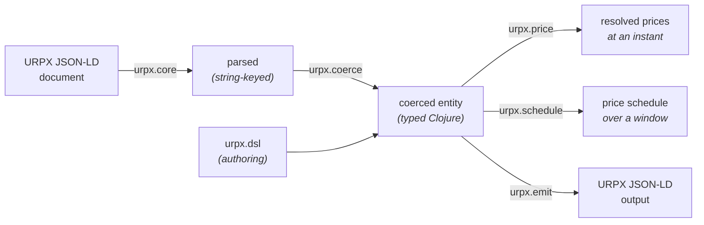

# clj-urpx

[](https://clojars.org/energy.grid-coordination/clj-urpx)
[](https://github.com/dcj/codox-md)
[](https://github.com/dcj/build-provenance)

Clojure library for [URPX](https://lfenergy.org/projects/utility-rate-plan-exchange-urpx/) (Utility Rate Plan Exchange) — parse, validate, and resolve prices from URPX rate plan documents (JSON-LD).

## What is URPX?

URPX is an [LF Energy](https://lfenergy.org/) open standard for exchanging utility rate plan information using semantic web technologies (RDF, OWL, SHACL, JSON-LD). It enables precise, machine-readable data exchange between utilities, regulators, vendors, and researchers.

The standard's source of truth — ontology, SHACL shapes, JSON-LD context, decision log, tutorial, and reference test cases — lives at [github.com/urpx-org/urpx](https://github.com/urpx-org/urpx). This library targets the same version-pinned ontology snapshot that fixtures cite via `urpx:targetURPXVersion`.

## What does this library do?

- **Parse** URPX JSON-LD rate plan documents into Clojure data structures
- **Validate & coerce** parsed data against [Malli](https://github.com/metosin/malli) schemas — string leaves become `BigDecimal`, `LocalDate`, `LocalTime`, `LocalDateTime`, `Duration`, `Period`, integer month numbers
- **Resolve** the per-ledger, per-tier prices that apply at a given instant in a given timezone — TOU period, season, day-of-week, midnight-wrapping brackets, block-tier ladders
- **Generate** contiguous price-interval schedules suitable for [OpenADR 3](https://www.openadr.org/) events
- **Emit** URPX JSON-LD from coerced Clojure entities (the inverse of parse + coerce) — useful for round-trip validation and programmatic authoring of URPX documents
- **Author** URPX entities idiomatically in Clojure via `urpx.dsl` — per-entity builders with auto-coercion, validation-on-construct, and local-symbol refs scoped via `dsl-scope`

## Library at a glance



Three paths share the same typed entity model:

- **Reading URPX docs** — load, coerce, and resolve prices → see [Usage](#usage)
- **Writing URPX docs** — emit JSON-LD from coerced entities → see [Writing URPX JSON-LD](#writing-urpx-json-ld)
- **Authoring URPX entities in Clojure** — build coerced entities idiomatically → see [Authoring URPX entities](#authoring-urpx-entities)

## Installation

`deps.edn`:

```clojure
{:deps {energy.grid-coordination/clj-urpx
        {:git/url "https://github.com/grid-coordination/clj-urpx.git"
         :git/sha "..."}}}
```

## Getting started

A five-minute walkthrough using the vendored PG&E E-1 fixture (a real Schedule E-1 filing with block-tier pricing and a sibling vintage-PCIA modifier in a single JSON-LD `@graph`). Runs from a cold clone — no env vars, no sibling checkouts.

```bash
git clone https://github.com/grid-coordination/clj-urpx.git
cd clj-urpx
clojure -M:nrepl   # nREPL on the port written to .nrepl-port
```

In the REPL:

```clojure
(require '[urpx.core :as core]
         '[urpx.coerce :as coerce]
         '[urpx.price :as price]
         '[urpx.test-fixtures :as fixtures])
(import '[java.time ZoneId ZonedDateTime])

;; 1. Load the vendored PG&E E-1 fixture: a urpx:RatePlan + sibling urpx:RatePlanModifier
(def plan     (fixtures/load-rate-plan "pge-e-1-2026-03-01"))
(def modifier (fixtures/load-modifier  "pge-e-1-2026-03-01"))

;; 2. Resolve prices for July 4 2026 at 5pm Pacific (Summer, weekend, holiday)
(def la (ZoneId/of "America/Los_Angeles"))
(def july-4-evening (ZonedDateTime/of 2026 7 4 17 0 0 0 la))

(def resolved
  (price/resolve-prices-with-modifiers plan [modifier] july-4-evening))

(:urpx.resolved/season-name resolved)
;; => "Summer"

(mapv :urpx.resolved/ledger-name (:urpx.resolved/ledgers resolved))
;; => ["Energy Supply Prices" "Energy Delivery Prices" "Adjustment Prices"
;;     "Conservation Incentive Adjustment"
;;     "Vintaged Power Charge Indifference Adjustment"]

;; 3. Marginal $/kWh — sum of the lowest-tier unit-prices across energy ledgers.
;;    The vintage-PCIA modifier prices one ledger per departure vintage. Those
;;    are mutually-exclusive ALTERNATIVES, exactly one of which applies to a
;;    customer, so say which one: without a selection `marginal-unit-rate`
;;    refuses rather than pick arbitrarily.
(def with-vintage
  (price/resolve-prices-with-modifiers
   plan [modifier] july-4-evening
   {:profile-alternatives {"pge:pa-departure-vintage" "pge:pa-vintage-2020"}}))

(price/marginal-unit-rate with-vintage)
;; => some BigDecimal in the [0, 1] range
```

Calling `marginal-unit-rate` on `resolved` instead, with no selection, throws `ExceptionInfo` naming the ledger: an aggregate that silently took one of eighteen mutually-exclusive prices would be reporting an arbitrary number as the marginal rate. Reading `:urpx.resolved/tiers` directly needs no selection, and still surfaces all eighteen.

That covers the consume side end-to-end. For emit and authoring, jump to [Writing URPX JSON-LD](#writing-urpx-json-ld) and [Authoring URPX entities](#authoring-urpx-entities) — both compose with the coerced entity above.

## Usage

```clojure
(require '[urpx.core :as core]
         '[urpx.coerce :as coerce]
         '[urpx.price :as price]
         '[urpx.schedule :as schedule])
(import '[java.time LocalDate ZoneId ZonedDateTime])

;; 1. Load and coerce a URPX rate plan document. v0.2.0 documents are
;;    typically @graph bundles holding a urpx:RatePlan plus sibling
;;    urpx:RatePlanModifier and metadata entities; load-rate-plan picks
;;    the unique RatePlan from the bundle.
(def plan
  (-> "path/to/urpx-rate-plan.jsonld"
      core/load-rate-plan
      coerce/coerce-rate-plan))

;; 2. Resolve the prices that apply at a specific instant
(def la (ZoneId/of "America/Los_Angeles"))
(price/resolve-prices plan (ZonedDateTime/of 2026 7 15 17 0 0 0 la))
;; =>
;; {:urpx.resolved/season-name        "Summer"
;;  :urpx.resolved/tou-period-name    "Summer Peak Period"
;;  :urpx.resolved/tou-period-number  1
;;  :urpx.resolved/ledgers
;;  [{:urpx.resolved/ledger-name "Energy Supply Prices"
;;    :urpx.resolved/tiers
;;    [{:urpx.resolved/price-name "Generation Summer Peak"
;;      :urpx.resolved/unit-price 0.20782M ...}
;;     {:urpx.resolved/price-name "Bundled Power Charge Indifference Adjustment"
;;      :urpx.resolved/unit-price -0.01011M ...}]}
;;   {:urpx.resolved/ledger-name "Energy Delivery Prices"
;;    :urpx.resolved/tiers [{:urpx.resolved/unit-price 0.20388M ...} ...]}
;;   {:urpx.resolved/ledger-name "Adjustment Prices" ...}]}

;; 3. Marginal $/kWh — sum of the lowest-tier unit-price across all ledgers
(price/marginal-unit-rate *1)

;; 4. Generate a day's worth of natural TOU intervals
(def start (.toInstant (.atStartOfDay (LocalDate/of 2026 7 15) la)))
(schedule/price-schedule-days plan start 1 la)
;; =>
;; [{:tick/beginning <ZDT 2026-07-15T00:00-07:00[America/Los_Angeles]>
;;   :tick/end       <ZDT 2026-07-15T16:00-07:00[America/Los_Angeles]>
;;   :urpx.interval/resolved {... "Summer Off-Peak Period" ...}}
;;  {... 16:00–21:00 "Summer Peak Period" ...}
;;  {... 21:00–24:00 "Summer Off-Peak Period" ...}]
```

For block-tiered plans (e.g. PG&E E-1), each ledger's `:tiers` vector exposes every tier with its `:tier-lower-bound`, `:tier-upper-bound`, and `:unit-price` — the caller selects the active tier from cumulative billing-period usage.

### Time and timezones

The library uses `java.time.ZonedDateTime` end-to-end internally and at output boundaries — DST-correct under daylight transitions because every step of the walk preserves zone, no `Instant`-to-local-time conversions in the middle of the schedule.

**Inputs and outputs:**

- `resolve-prices` takes a `ZonedDateTime` directly — its zone always comes from the caller
- `price-schedule` / `price-schedule-with-modifiers` take an `Instant`-shaped `[start, end)` window plus an optional `ZoneId` (the zone the walk is performed in)
- The schedule output's `:tick/beginning` and `:tick/end` are `ZonedDateTime` in the resolved zone. Callers wanting a plain `java.time.Instant` invoke `.toInstant` themselves at the call site

**Zone resolution order:**

1. Explicit `ZoneId` arg passed to `price-schedule` / `price-schedule-days` / `price-schedule-with-modifiers` / `price-schedule-days-with-modifiers`
2. Rate plan's `urpx:timezoneIdentifier` (an IANA string, e.g. `"America/Los_Angeles"`) — used when the zone arg is omitted

```clojure
(schedule/price-schedule-days plan start 1)            ; uses plan's declared zone
(schedule/price-schedule-days plan start 1 la)         ; explicit override
```

When neither is available, an `ex-info` is thrown rather than silently falling back to the system default.

**Standing rule:** pass an IANA `ZoneId` like `(ZoneId/of "America/Los_Angeles")` — never a fixed offset, never the system default.

**Inference fallback:** for documents that omit `urpx:timezoneIdentifier`, the optional `urpx.tz-inference/infer-zone` helper does best-effort inference from the publishing utility's `urpx:legalName` (and a caller-supplied `urpx:eiaId` table when available). It returns `nil` for unknown or multi-zone utilities so the caller fails loudly rather than silently picking one. Inference is **opt-in** — `price-schedule` does not call it automatically; compose at the call site:

```clojure
(require '[urpx.tz-inference :as tz])
(let [zone (or (some-> plan :urpx/timezoneIdentifier ZoneId/of)
               (:zone (tz/infer-zone plan))
               (throw (ex-info "no timezone for this plan" {})))]
  (schedule/price-schedule plan start end zone))
```

The shipped lookup tables only cover utilities used by the test suite; production deployments should supply their own (`:eia-id->zone` / `:legal-name->zone` opts).

### Holiday calendar

URPX `TimeBracket` carries two optional booleans — `urpx:includeHolidays` and `urpx:includeNonHolidays` — that gate whether the bracket applies on holidays, non-holidays, or both (both default to `true` when omitted, matching every day). For plans that use these gates (e.g. PG&E E-TOU-D's "weekday peak EXCLUDING holidays" pattern), the resolver picks a holiday predicate in this order:

1. **Explicit `:holiday?` in opts** — caller-supplied predicate `(LocalDate -> bool)` always wins.
2. **Embedded `urpx:HolidayCalendar`** — if the plan declares one (PG&E E-TOU-D and several CPAU filings do), `urpx.holidays/derive-predicate` builds a predicate from the calendar's `urpx:Holiday` entries (literal dates plus rule-based descriptions like "fourth Thursday of November"). No caller setup required.
3. **Fallback** — only when both of the above are absent: every date is treated as a non-holiday. Brackets that opt out of non-holidays (`includeNonHolidays: false`, e.g. holiday-only off-peak overrides) will never match.

A caller-supplied `:holiday?` overrides any embedded calendar — useful when you need a different jurisdiction's holiday set or want to inject a calendar service:

```clojure
(import '[java.time LocalDate])

(def us-federal-2026
  #{(LocalDate/of 2026 1 1)    ; New Year's Day
    (LocalDate/of 2026 1 19)   ; Martin Luther King Jr. Day
    (LocalDate/of 2026 2 16)   ; Presidents Day
    (LocalDate/of 2026 5 25)   ; Memorial Day
    (LocalDate/of 2026 6 19)   ; Juneteenth
    (LocalDate/of 2026 7 3)    ; Independence Day (observed)
    (LocalDate/of 2026 9 7)    ; Labor Day
    (LocalDate/of 2026 11 11)  ; Veterans Day
    (LocalDate/of 2026 11 26)  ; Thanksgiving
    (LocalDate/of 2026 12 25)})  ; Christmas

(price/resolve-prices plan zdt {:holiday? us-federal-2026})
(schedule/price-schedule plan start end la {:holiday? us-federal-2026})
```

A plain set of `LocalDate`s works because sets are functions; you can also pass any `(LocalDate -> bool)` function — e.g. one that delegates to an external calendar service.

### Modifiers

`urpx:RatePlanModifier` documents (vintage-PCIA adders, export-compensation adjusters, etc.) augment a base plan. They appear in three packaging shapes — the loader handles all three transparently:

- **`@graph` bundle**: a single document holds a base `urpx:RatePlan` plus one or more sibling modifiers (PG&E filings).
- **Wrapper**: a `urpx:URPXDocument` (the v0.2.0 wrapper class) or `urpx:URPXPackage` (its v0.3.0 rename) whose `urpx:hasRatePlanModifier` or `urpx:packages` points at the modifier.
- **Standalone filing**: a document whose only entity is `urpx:RatePlanModifier` (CPAU E-2-G shape — modifier-only filings whose target linkage is expressed by consumer-side composition).

Pull the modifier with `core/load-rate-plan-modifier`, parallel to `load-rate-plan`:

```clojure
(def modifier
  (-> "path/to/urpx-rate-plan-modifier.jsonld"
      core/load-rate-plan-modifier
      coerce/coerce-rate-plan-modifier))

(price/resolve-prices-with-modifiers plan [modifier] zdt)
;; => the resolve-prices output, with each applicable modifier's ledgers
;;    appended to :urpx.resolved/ledgers
```

`urpx:applicableToRatePlan` (modifier → base plan linkage) is optional per URPX SHACL — bundled modifiers usually declare it, standalone ones may not. `resolve-prices-with-modifiers` only includes modifiers whose `applicableToRatePlan` list contains the base plan's `@id`; modifiers without an applicableToRatePlan are skipped on the assumption that their applicability is decided externally. Pass them explicitly (or trim the list yourself) when you've verified the target.

Modifier `PriceDefinition`s carrying `urpx:touPeriodNumber` are gated symmetrically with base PDs: if the modifier defines its own `urpx:hasTOUSchedule` the resolver walks it at the probe instant and gates against the modifier's resolved period; otherwise the gate uses the base RatePlan's resolved period (so e.g. a modifier whose discounts ride the base's Mid-Peak / Off-Peak periods only surfaces in those windows). Modifier PDs without `touPeriodNumber` are unaffected.

Matrix-style modifiers (e.g. PG&E vintage-PCIA, one ledger with a price per departure-vintage year) surface every active price under one ledger entry; the caller picks the active value via `:urpx.resolved/price-id`. The selection dimension is carried by `urpx:PriceSetAlternatives`: each `PriceSetAlternative` names its `urpx:referencesProfileAlternative`, and the set names the `urpx:ProfileAlternatives` it discriminates on.

These prices are **alternatives, not tiers**: exactly one applies to any customer. Pass `:profile-alternatives` to choose one, exactly as on the base plan path, and only the chosen alternative surfaces. Without a selection all of them surface and the ledger carries `:urpx.resolved/unselected-alternatives`; `marginal-unit-rate` then **refuses**, because an aggregate that took one of eighteen mutually-exclusive prices would be reporting an arbitrary number as the marginal rate.

Prices carrying `urpx:hasDynamicPricing` (CPP Event Charges, RTP overlays, other event-driven components — applicable to base PDs and modifier PDs alike per the SHACL Price shape) are surfaced with the DynamicPricing payload attached to the resolved tier under `:urpx.resolved/dynamic-pricing`. Consumers wanting a non-event marginal rate filter on the absence of that key; consumers evaluating event state at billing time read the nested `:urpx/dynamicPricingType`, `:urpx/priceSource`, `:urpx/updateFrequency`, and `:urpx/hasPriceUpdateRule`. The resolver itself does not (yet) gate on event state — that's a caller-side responsibility until URPX standardizes a consumer-facing event-state API.

### Derived prices and price summaries

A `urpx:Price` need not state a `urpx:unitPrice`. It may instead carry `urpx:multiplier` together with `urpx:basedOnPrice`, naming the price it is computed from. That is how a percentage discount such as CARE or FERA is filed: the discount is a multiplier over a `urpx:PriceSummary`, which aggregates the line items the discount applies to via `urpx:includesPrice` (`sh:minCount 2` upstream). A summary hangs off a `urpx:PriceSet` or `urpx:PriceSetAlternative` through `urpx:hasPriceSummary`, beside the prices it names.

`resolve-prices` values these automatically: the multiplier times the referenced Price's unit price, or times the sum of the summary's members **that are in effect at the instant being resolved**. Members are gated by the same season, month and TOU predicates that gate a tier, applied to each member's own `PriceDefinition`. A subtotal is turned into a unit price at an instant, so summing a winter line item into a July resolution would simply be the wrong number. This means one summary per base plan can name every discountable line item and still be correct in every TOU period; if no member is in effect, the result is `:summary-no-active-members` rather than a confident zero.

Which members a summary names is the author's business, and the resolver reads the list as filed rather than inferring one.

The discount and the summary often live in different filings, because the discount belongs to a program modifier while the line items belong to the base plan. `resolve-prices-with-modifiers` resolves that case, since the caller has already supplied both documents and the `@id` index spans exactly what was passed in:

```clojure
(price/resolve-prices-with-modifiers plan [care-modifier] zdt)
;; the modifier's discount Price resolves against the base plan's PriceSummary
```

Nothing is fetched behind your back. A reference this library cannot resolve from the documents it was given is reported, never silently valued:

```clojure
;; a tier whose Price could not be valued
#:urpx.resolved{:price-id "sdge:price-care-discount"
                :unit-price nil
                :unvaluable {:reason :unresolved-reference
                             :price-id "sdge:price-care-discount"
                             :detail "urpx:basedOnPrice names ..."}}
```

The reasons are:

| reason | meaning |
|---|---|
| `:unresolved-reference` | no named basis is in the documents passed to the call |
| `:ambiguous-basis` | two or more named bases are present at once, which is not a choice this library makes |
| `:summary-member-unresolved` | a summary member is absent from these documents, or is in effect here but carries no unit price |
| `:summary-no-active-members` | no member of the summary is in effect at this instant, so its subtotal is undefined here |
| `:basis-not-valuable` | the basis resolved but has no unit price |
| `:no-unit-price` | the Price states neither a unit price nor a multiplier and basis to derive one from |

A nil unit price with no explanation would read to a consumer as free, which for a discount is the worst available answer; `marginal-unit-rate` therefore throws rather than return one.

`urpx:basedOnPrice` has no `sh:maxCount` upstream, so a document may name several bases. Several values are read **disjunctively**: candidate bases, of which exactly one is expected to be present in the documents passed to the call. That is what lets a single discount Price serve a modifier applying to many base plans, naming each base's subtotal and letting the composition select by which base was actually supplied. Zero resolvable candidates remains an error, and two or more present at once reports `:ambiguous-basis`.

The conjunctive reading (sum the bases) is already covered by `urpx:PriceSummary`, whose `urpx:includesPrice` is the aggregation construct. URPX fixes the cardinality of `urpx:basedOnPrice` and says nothing about what multiple values mean, so the disjunctive reading is this library's, stated here rather than left implicit.

Note that this is a second, independent way to express CARE and FERA. The `urpx:ProfileAlternatives` mechanism below files the already-discounted prices directly as an alternative price set; this one files the discount as arithmetic over the undiscounted prices. Which a plan uses is the filer's choice, and a reader should expect either.

### Customer-profile alternatives

URPX v0.2.0 introduced `urpx:ProfileAlternatives` + `urpx:PriceSetAlternatives` for declarative customer-or-configuration choices — income-tier CARE / FERA / Standard, voltage configurations, vintage-PCIA default tier, and similar. The plan declares a `urpx:ProfileAlternatives` at `PlanElements.hasProfileAlternatives` (each named alternative carries its own `hasConditionExpression`), and a sibling `urpx:PriceSetAlternatives` at `Prices.hasPriceSetAlternatives` exposes one Price-bearing `PriceSetAlternative` per alternative.

`resolve-prices` selects the active alternative explicitly via the `:profile-alternatives` opt — a `{<ProfileAlternatives @id> <chosen ProfileAlternative @id>}` map. `resolve-prices-with-modifiers` honors the same opt on the modifier path, which is how a matrix modifier's alternatives are chosen:

```clojure
(price/resolve-prices plan zdt
  {:profile-alternatives
   {"pge:bsc-income-tier" "pge:bsc-care"}})
```

Unmapped alternatives are silently skipped — only the explicitly-chosen alternative's prices surface. Programmatic evaluation of each alternative's `urpx:ConditionExpression` against a customer profile is a future enhancement.

### Sub-hour granularity

`price-schedule` walks at hourly steps by default. For rate plans that define sub-hour TOU bracket transitions, pass `:step`:

```clojure
(import '[java.time Duration])
(schedule/price-schedule plan start end la {:step (Duration/ofMinutes 15)})
```

Adjacent steps with identical resolved ledgers are still merged, so a quarter-hour walk across an hour-aligned plan produces the same merged intervals as the hourly walk.

## Writing URPX JSON-LD

The library also supports the inverse direction: emit URPX JSON-LD from a coerced Clojure entity. Useful for round-trip validation, programmatic generation of URPX documents, and authoring fixtures in idiomatic Clojure.

```clojure
(require '[urpx.emit :as emit])

;; Round-trip a parsed rate plan back to JSON-LD
(spit "out.jsonld" (emit/write-rate-plan plan))

;; Standalone modifier documents
(emit/write-rate-plan-modifier modifier)

;; URPXDocument-wrapped documents (v0.2.0 wrapper class)
(emit/write-urpx-document
  {:jsonld/type "urpx:URPXDocument"
   :urpx/targetURPXVersion "https://github.com/urpx-org/urpx/raw/v0.2.0/ontology/urpx-ontology.ttl"
   :urpx/hasRatePlan [plan]})

;; urpx:URPXPackage, the v0.3.0 rename of that wrapper
(emit/write-urpx-package
  {:jsonld/type "urpx:URPXPackage"
   :urpx/targetURPXVersion "https://github.com/urpx-org/urpx/raw/v0.5.1/ontology/urpx-ontology.ttl"
   :urpx/packages [plan]})
```

Each function takes a coerced (or already-typed EDN) entity, runs the schema's `:encode/urpx-jsonld` transformer to convert typed leaves (`BigDecimal`, `LocalDate`, `LocalDateTime`, `Duration`, integer month numbers, …) back to JSON-LD string forms, projects namespaced-keyword keys to their CURIE / `@`-reserved JSON-LD forms, and serializes via `clojure.data.json/write-str`.

### Worked round-trip

```clojure
(require '[urpx.core :as core] '[urpx.coerce :as coerce] '[urpx.emit :as emit])
(import '[java.io StringReader])

;; load + coerce → typed entity
(def plan (-> "path/to/urpx-rate-plan.jsonld"
              core/load-rate-plan
              coerce/coerce-rate-plan))

;; emit → JSON-LD string → re-parse → re-coerce
(def re-coerced (-> (emit/write-rate-plan plan)
                    StringReader.
                    core/parse-rate-plan
                    coerce/coerce-rate-plan))

(= plan re-coerced)
;; => true (the round-trip is a fixed point)
```

### `@context` emission

By default, every write-* function emits a baseline `@context` with the canonical URPX prefix declarations (`urpx`, `schema`, `xsd`) plus typed-property declarations matching the shape vendored fixtures carry — output parses cleanly with strict JSON-LD processors out of the box. The full default context lives at [`urpx.emit/default-context`](src/urpx/emit.clj).

```clojure
;; Default context (most use cases)
(emit/write-rate-plan plan)

;; Caller-supplied context (replaces the default verbatim)
(emit/write-rate-plan plan {:context {"urpx" "https://urpx-org.github.io/urpx/ontology/"
                                      "ex"   "https://example.com/foo/"}})

;; Suppress @context entirely
(emit/write-rate-plan plan {:context nil})
```

A `@context` already present on the input entity (e.g. from a parsed document) is preserved untouched — the default never clobbers a context the consumer supplied.

### Round-trip fidelity

The emit path targets **logical / RDF-graph equivalence** on round-trip: `parse → coerce → emit → re-parse → re-coerce` yields a structurally equal Clojure entity. Byte-for-byte equality with the input is **not** a goal — key ordering, single-vs-vector property emission, and `@context` recreation may differ from the source document.

`urpx.emit-test` runs an authoritative round-trip suite over every vendored fixture (PG&E E-1, E-TOU-C, E-TOU-D, EV2 — both the base RatePlan and the bundled vintage-PCIA modifier in each `@graph`) plus a URPXDocument-wrapped E-ELEC document; all round-trip cleanly with plain `(= original re-coerced)`. The DSL test suite (`urpx.dsl-test`) extends this to a CPAU-E-2-shaped plan authored entirely via the DSL.

## Authoring URPX entities

For programmatic construction or test-fixture authoring, `urpx.dsl` provides idiomatic Clojure builders for every entity-type schema in `urpx.schema`. Output is a coerced (typed) entity, ready for `urpx.price/resolve-prices`, `urpx.emit/write-*`, or any other consumer.

```clojure
(require '[urpx.dsl :as dsl])

(dsl/dsl-scope
  (let [summer (dsl/season ::summer :season-name "Summer" :month [5 6 7 8 9 10])
        winter (dsl/season ::winter :season-name "Winter" :month [11 12 1 2 3 4])
        ledger-comm (dsl/ledger ::ledger-commodity
                                :name "Commodity"
                                :ledger-type {:jsonld/id "urpx:supplyLedger"})
        pd-cs (dsl/price-definition ::pd-commodity-summer
                                    :name "Commodity Summer"
                                    :applies-in-season ::summer
                                    :references-ledger ::ledger-commodity)]
    ;; ...assemble into a rate-plan via dsl/rate-plan, dsl/rate-plan-version, etc.
    ))
```

The DSL handles the boring parts so authoring code stays declarative:

- **`@type` is inferred** from the schema (no `:jsonld/type "urpx:Season"` boilerplate).
- **Auto-coercion** of raw Clojure inputs through the schema's `:decode/urpx-jsonld` decoders: numbers → `BigDecimal`, ISO strings → `LocalDate` / `LocalDateTime` / `LocalTime`, `--MM` xsd:gMonth → int.
- **Validation on construct** — every builder throws `ex-info` with the Malli explanation if the entity doesn't validate against its schema, so shape drift surfaces at the call site.
- **Two kwarg forms** — canonical `:urpx/seasonName` or auto-derived kebab-case `:season-name` (both work, can be mixed in one call).

### Local-symbol refs

Inside a `dsl-scope`, builders accept an optional leading qualified-keyword as the entity's local `@id`, and qualified-keyword values in kwarg positions resolve to `{:jsonld/id …}` Ref maps via the scope's registry:

```clojure
(dsl/dsl-scope
  (dsl/season ::summer :season-name "Summer" :month [5 6 7 8 9 10])
  (dsl/season ::winter :season-name "Winter" :month [11 12 1 2 3 4])
  (dsl/price-definition ::pd-summer
                        :applies-in-season ::summer    ; → {:jsonld/id "summer"}
                        :references-ledger ::commodity))
```

Resolution is eager (declare-before-reference); unknown refs and duplicate declarations throw. Each `dsl-scope` has its own registry — scopes don't leak.

### Building from arbitrary schemas

`make-builder` derives a constructor from any Malli schema with a `:jsonld/type [:= "urpx:X"]` entry — useful for ad-hoc construction or scripts that don't import every named builder:

```clojure
(let [build-tou-period (dsl/make-builder schema/TOUPeriod)]
  (build-tou-period :urpx/name "Summer Peak"
                    :urpx/touPeriodNumber 1
                    :urpx/hasTimeBracket []))
```

The named builders (`season`, `metric-input`, `price-definition`, `rate-plan`, `urpx-package`, `coverage-claim`, …) are each just `(def name (make-builder schema/X))`, one for every entity-type schema in `urpx.schema` with no exceptions — a test pins that, because the claim had quietly become false for eleven schemas. Where a schema dual-accepts two `@type` spellings (`source-publication`), the builder sets the v0.5.1 one and the schema still validates the v0.2.x one on parse.

For a longer worked walkthrough that mirrors selected examples from the upstream [URPX Tutorial](https://github.com/urpx-org/urpx/blob/main/documentation/pages/urpx-tutorial.md), see [`doc/dsl-tutorial.md`](doc/dsl-tutorial.md) — each example shows the canonical URPX JSON-LD shape and the equivalent DSL form, with deep-links back to the upstream source section.

## Namespace overview

| Namespace        | Purpose |
|------------------|---------|
| `urpx.core`          | JSON-LD parsing and loading (`parse-rate-plan`, `load-rate-plan`, `load-rate-plan-version`, `parse-graph`, `load-graph`, `expand-document-entities`) |
| `urpx.schema`    | Malli schemas for the coerced URPX entity model |
| `urpx.coerce`    | Schema-driven coercion: strings → typed values; `validate`, `explain` |
| `urpx.index`     | `build-index`, `resolve-ref`, `get-entity` for `@id` references; `versions-by-plan` for v0.5.1 back-pointers; `single` and `entities-of-type` |
| `urpx.price`         | `resolve-prices`, `resolve-modifier-prices`, `resolve-prices-with-modifiers`, `marginal-unit-rate` |
| `urpx.schedule`      | `price-schedule`, `price-schedule-days`, `price-schedule-with-modifiers`, `price-schedule-days-with-modifiers` |
| `urpx.tz-inference`  | `infer-zone` (opt-in fallback when `urpx:timezoneIdentifier` is absent) |
| `urpx.emit`          | Write-side: `write-rate-plan`, `write-rate-plan-modifier`, `write-urpx-document`, `write-urpx-package` |
| `urpx.validate`      | Single-file CLI checker (`clojure -M:validate <file.jsonld>`), tri-state exit |
| `urpx.dsl`           | Authoring DSL: `dsl-scope`, `make-builder`, named builders for every entity type |

## Status

Targets **URPX v0.5.1** (urpx-org/urpx `95eb8e22`) while continuing to accept **v0.2.x** in full.

That dual acceptance is deliberate, not transitional debt: the production corpus migrates utility by utility in six waves and carries both vocabularies at once for the whole migration, so anything phrased as a hard cut is wrong until the last wave lands. Where v0.5.1 renamed or moved something, both spellings validate; where it made something required that v0.2.x never had, clj-urpx models it optional and says so at the site.

Release history is in [CHANGELOG.md](CHANGELOG.md).

Test fixtures are vendored from [urpx-rate-plans](https://github.com/grid-coordination/urpx-rate-plans) (the production rate-plan corpus) at pinned commits — see [`test/resources/urpx-fixtures/FIXTURES.md`](test/resources/urpx-fixtures/FIXTURES.md) for the table and the re-sync workflow.

Currently covered:

- Top-level document classes parse, coerce and validate against Malli schemas: `urpx:RatePlan`, `urpx:RatePlanModifier`, both version snapshots, and both wrapper classes. The loader descends a wrapper transparently, so consumers target inner entities by `@type` regardless of packaging shape (bare entity, `@graph` bundle, or wrapper). `urpx.core/expand-document-entities` exposes that descent for consumers walking a document themselves
- Both wrapper vocabularies at once: `urpx:URPXDocument` and `urpx:URPXPackage`, its v0.3.0 rename, which drops `urpx:hasTariffPublication` and adds the general `urpx:packages` containment pointer
- **The version hop resolves either direction.** v0.5.1 un-nests the snapshot: a document may state the plan-to-version link downward (`urpx:hasRatePlanVersion`, nested), upward (`urpx:forRatePlan` on a top-level snapshot), or both. `urpx.index/versions-by-plan` indexes the back-pointer, and `resolve-prices` takes an explicit `:version`, falls back to the nested pointer, then to that index. Both pointers are 0..N upstream and are accepted as such; with more than one nested snapshot and no explicit choice, resolution throws rather than picking arbitrarily, because which snapshot applies to an instant is a selection question the vocabulary does not yet settle
- **v0.5.1 coverage machinery**: `urpx:CoverageClaim`, `urpx:Evaluation`, `urpx:ModelExclusion` and `urpx:PriceDefinitionReference`, with `urpx:forRatePlan` and `urpx:hasCoverageClaim` on the snapshots. Both are `sh:minCount 1` upstream and are held optional here until the last migration wave
- **Enum membership is enforced** on the reframe vocabularies (`completenessResult`, `referenceInclusion`, `confidence`, `evaluationKind`, `exclusionReason`, `publicationType`), transcribed from the shipped `sh:in` lists. `publicationType` also accepts `urpx:regulatoryFiling`, a member of the retired 10-member class with no v0.5.1 successor that is the only value the corpus actually uses
- **The publication split**: `urpx:SourcePublication` (dual-accepting the v0.2.x `urpx:TariffPublication` `@type`) and `urpx:TariffFiling`
- **Typed identity**: `RatePlanIdentifier`, `RatePlanModifierIdentifier` and `OrganizationIdentifier` on plans, modifiers and their snapshots, each requiring `skos:notation` and `urpx:scheme`. `urpx:IdentifierScheme` is an open class upstream, so an implementer's own scheme IRI is accepted
- **`DataSourceReference` flattening**: v0.5.1 deleted `urpx:TariffBookReference` and `urpx:TariffStatementReference` and hoisted their fields inline; both forms validate
- `Price.hasApplicabilityRule` and `PriceSetAlternative.hasApplicabilityRule` take either an inline `urpx:ApplicabilityRule` or a bare `@id` reference to one defined elsewhere in the document, since RDF merges a reference with its definition. The reference arm is closed to `@id` alone, so a malformed inline node cannot pass as a reference
- `@context` in all three JSON-LD encodings: a definition object, an IRI string, or an array mixing the two, which is the form every shipped v0.5.1 example uses
- Timezone inference reads `urpx:offeredBy` on a snapshot, the v0.5.1 successor to `urpx:publishedBy`, which was removed from the version shapes
- `Price.hasApplicabilityRule` and `PriceSetAlternative.hasApplicabilityRule` take either an inline `urpx:ApplicabilityRule` or a bare `@id` reference to one defined elsewhere in the document, since RDF merges a reference with its definition
- Modifier filings in all three packaging shapes — bundled with a base RatePlan in `@graph`, carried by a wrapper, or standalone (no in-document target linkage; consumer-side composition expected) — load via `core/load-rate-plan-modifier`
- v0.2.0 `urpx:ConditionExpression` tree (Comparison/Boolean nodes with Object/Datatype/Custom operand leaves) parses and coerces; recursive operands are validated through a local Malli registry
- v0.2.0 `BillingModel.hasPriceDefinition` traversal (PD now lives at the BillingModel level with `referencesLedger` pointing back) for price resolution
- TOU period resolution: seasons, ontology day-types (`urpx:allDays`, `urpx:weekdayDays`, `urpx:weekendDays`, `urpx:customDays`), `urpx:includeHolidays` / `urpx:includeNonHolidays` bracket gates, time-bracket containment with midnight wrap. Multiple `urpx:TOUSchedule`s per BillingModel are supported (one per MetricInput, e.g. separate energy + demand schedules)
- Non-TOU seasonal gating via `PriceDefinition.appliesInSeason → Season.month`, alongside the existing `hasApplicabilityRule.month` path — handles filings whose seasonal partition isn't carried by a TOUPeriod indirection (CPAU E-2 shape)
- `RatePlanVersion` surfaces `urpx:hasModifierOptions` and `urpx:hasModifierVersionOptions` pointers (Decisions #084 + #090) for cross-version modifier wiring
- Block-tier surfacing via the v0.2.0 `urpx:ServiceTiers` container — every tier surfaces with its bounds and bound operators
- Active-price selection by latest `startDate ≤ query-date`, drawing from flat top-level prices, `PriceSet`-scoped prices, and PriceSets that omit `startDate` and fall through to per-Price dates (CPAU E-2 shape, per `urpx:PriceSetShape` `sh:minCount 0`)
- Modifier resolution alongside the base plan (vintage-PCIA pattern: many Prices share one PD, discriminated by `urpx:PriceSetAlternatives` / `urpx:referencesProfileAlternative`, and selected with `:profile-alternatives`)
- `urpx:ProfileAlternatives` + `urpx:PriceSetAlternatives` — the v0.2.0 idiom for declarative customer-or-configuration choices (income tier CARE/FERA/Standard, voltage configuration, vintage-PCIA default tier). Coerce + validate full schemas; resolve-prices selects the active alternative via an explicit `:profile-alternatives` opt; emit round-trips cleanly. Programmatic `ConditionExpression` evaluation against a customer profile is a future enhancement
- Configurable schedule step (hourly default; sub-hour available via `:step`)
- Symmetric write-side: `urpx.emit` emits JSON-LD from any coerced `RatePlan` / `RatePlanModifier` / `URPXDocument`; the vendored-fixture round-trip suite verifies `parse → coerce → emit → re-parse → re-coerce` is a fixed point for every PG&E filing × {RatePlan, Modifier} plus a URPXDocument-wrapped E-ELEC test case
- Authoring DSL (`urpx.dsl`): named builders for every entity-type schema, kebab-case kwarg aliases, auto-coercion of raw inputs (numbers → BigDecimal, ISO strings → java.time, `--MM` → int month), validation-on-construct, and local-symbol refs scoped via `dsl-scope`

Known gaps:

- Programmatic interpretation of `urpx:ConditionExpression` for active-tier selection in matrix-style modifiers — currently the caller picks the active value by `price-id` after walking the condition tree itself
- A handful of v0.2.0 SHACL classes that appear as references but aren't deeply modeled — `urpx:TariffPublication`, `urpx:ProgramEnrollment`, `urpx:ServicePointProfile`, plus the non-RatePlan URPXDocument subclasses (`urpx:TariffStatementDocument`, `urpx:DERExportsDocument`, `urpx:HighlyDynamicPricesDocument`, `urpx:SupplyChargesDocument`). They round-trip correctly as opaque maps via `:map`-typed payload pointers; deeper modeling (named builders, validation) lands as consumers need it.

## Checking for drift against the standard

`scripts/shacl-drift.sh <path-to-urpx-checkout> [rev]` reports where these hand-written Malli schemas have fallen behind the shipped SHACL shapes: properties the standard requires that aren't modeled, cardinalities that disagree, enum members that moved. It reads the shapes out of a checkout you point it at rather than vendoring them, and needs `rdflib` on the `python3` that runs it.

It is an auditor, not a generator. Nothing it produces is compiled or shipped. Deliberate divergence lives in [`dev/drift-baseline.edn`](dev/drift-baseline.edn) with a written reason; a known bug does not, because silencing it there is how it stops being known. See [CONTRIBUTING](CONTRIBUTING.md) for the finding taxonomy, and [SHACL and Malli](doc/shacl-and-malli.md) for why the schemas are hand-written rather than generated from the shapes, with the measurements behind that.

## Command-line validation

Check any single URPX JSON-LD file, which is what a per-wave conversion smoke test needs while a corpus migrates utility by utility:

```bash
clojure -M:validate path/to/filing.jsonld [more.jsonld ...]
```

Wrappers are descended, so a `urpx:URPXDocument` or `urpx:URPXPackage` is checked through to the `urpx:RatePlan` inside it rather than at the wrapper metadata alone. Exit codes are tri-state so a run that checked nothing cannot read as success: `0` everything valid, `1` at least one entity failed, `2` refused because a path was unreadable or a file yielded no entity this library models.

## See also

- [URPX standard](https://github.com/urpx-org/urpx) — ontology, SHACL shapes, decision log, tutorial, and reference test cases (the upstream specification this library targets)
- [urpx-rate-plans](https://github.com/grid-coordination/urpx-rate-plans) — production corpus of California utility rate-plan filings; vendored test fixtures here are pinned snapshots from there
- [LF Energy URPX project page](https://lfenergy.org/projects/utility-rate-plan-exchange-urpx/) — broader context for the URPX initiative
- [`doc/dsl-tutorial.md`](doc/dsl-tutorial.md) — worked DSL examples mirroring sections of the upstream URPX tutorial

## Contributing

Issues, Discussions, and pull requests are welcome — see [CONTRIBUTING.md](CONTRIBUTING.md) for the workflow (and the dev commands: tests, lint, nREPL). In short:

- **Questions, API/design discussion, vocabulary gaps** → [Discussions](https://github.com/grid-coordination/clj-urpx/discussions)
- **Confirmed bugs, schema/resolver fixes, doc errors** → [Issues](https://github.com/grid-coordination/clj-urpx/issues)
- **Patches** → pull requests; please open a Discussion or Issue first for non-trivial changes (new schema classes, new DSL builders, new resolver behavior)

## License

Copyright (c) 2026 Clark Communications Corporation. [MIT License](LICENSE).
