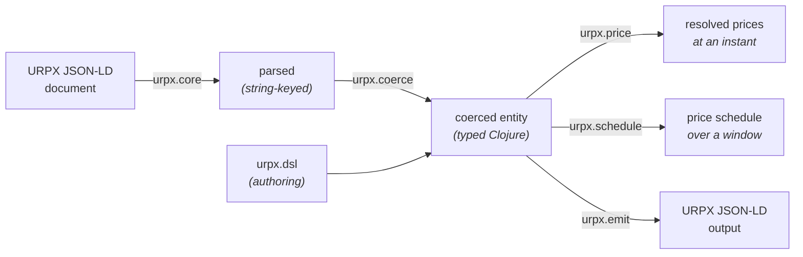

# clj-urpx

[](https://clojars.org/energy.grid-coordination/clj-urpx)
[](https://github.com/dcj/codox-md)
[](https://github.com/dcj/build-provenance)

Clojure library for [URPX](https://lfenergy.org/projects/utility-rate-plan-exchange-urpx/) (Utility Rate Plan Exchange) — parse, validate, and resolve prices from URPX rate plan documents (JSON-LD).

## What is URPX?

URPX is an [LF Energy](https://lfenergy.org/) open standard for exchanging utility rate plan information using semantic web technologies (RDF, OWL, SHACL, JSON-LD). It enables precise, machine-readable data exchange between utilities, regulators, vendors, and researchers.

The standard's source of truth — ontology, SHACL shapes, JSON-LD context, tutorial, and reference test cases — lives at [github.com/urpx-org/urpx](https://github.com/urpx-org/urpx); its design-decision logs are maintained in [urpx-org/urpx-dev](https://github.com/urpx-org/urpx-dev). This library targets the same version-pinned ontology snapshot that fixtures cite via `urpx:targetURPXVersion`.

> **Repository access:** [urpx-org/urpx](https://github.com/urpx-org/urpx), [urpx-org/urpx-dev](https://github.com/urpx-org/urpx-dev) and [grid-coordination/urpx-rate-plans](https://github.com/grid-coordination/urpx-rate-plans) are not yet public. Links to them resolve once each one is.

## What does this library do?

- **Parse** URPX JSON-LD rate plan documents into Clojure data structures
- **Validate & coerce** parsed data against [Malli](https://github.com/metosin/malli) schemas — string leaves become `BigDecimal`, `LocalDate`, `LocalTime`, `LocalDateTime`, `ZonedDateTime`, `OffsetTime`, `Duration`, `Period`, integer month numbers
- **Resolve** the per-ledger, per-tier prices that apply at a given instant in a given timezone — TOU period, season, day-of-week, midnight-wrapping brackets, block-tier ladders
- **Generate** contiguous price-interval schedules suitable for [OpenADR 3](https://www.openadr.org/) events, either sampled on a grid or as exact segments whose boundaries come from the tariff
- **Emit** URPX JSON-LD from coerced Clojure entities (the inverse of parse + coerce) — useful for round-trip validation and programmatic authoring of URPX documents
- **Author** URPX entities idiomatically in Clojure via `urpx.dsl` — per-entity builders with auto-coercion, validation-on-construct, and keyword refs scoped via `dsl-scope`

## Library at a glance



Three paths share the same typed entity model:

- **Reading URPX docs** — load, coerce, and resolve prices → see [Usage](#usage)
- **Writing URPX docs** — emit JSON-LD from coerced entities → see [Writing URPX JSON-LD](#writing-urpx-json-ld)
- **Authoring URPX entities in Clojure** — build coerced entities idiomatically → see [Authoring URPX entities](#authoring-urpx-entities)

## Installation

`deps.edn`:

```clojure
{:deps {energy.grid-coordination/clj-urpx {:mvn/version "0.47.0"}}}
```

## Getting started

A five-minute walkthrough using the vendored PG&E E-1 fixture (a real Schedule E-1 filing with block-tier pricing and a sibling vintage-PCIA modifier in a single JSON-LD `@graph`). Runs from a cold clone — no env vars, no sibling checkouts.

```bash
git clone https://github.com/grid-coordination/clj-urpx.git
cd clj-urpx
clojure -M:nrepl   # nREPL on the port written to .nrepl-port
```

In the REPL:

```clojure
(require '[urpx.core :as core]
         '[urpx.coerce :as coerce]
         '[urpx.price :as price]
         '[urpx.test-fixtures :as fixtures])
(import '[java.time ZoneId ZonedDateTime])

;; 1. Load the vendored PG&E E-1 fixture: a urpx:RatePlan + sibling urpx:RatePlanModifier
(def plan     (fixtures/load-rate-plan "pge-e-1-2026-03-01"))
(def modifier (fixtures/load-modifier  "pge-e-1-2026-03-01"))

;; 2. Resolve prices for July 4 2026 at 5pm Pacific (Summer, weekend, holiday)
(def la (ZoneId/of "America/Los_Angeles"))
(def july-4-evening (ZonedDateTime/of 2026 7 4 17 0 0 0 la))

(def resolved
  (price/resolve-prices-with-modifiers plan [modifier] july-4-evening))

(:urpx.resolved/season-name resolved)
;; => "Summer"

(mapv :urpx.resolved/ledger-name (:urpx.resolved/ledgers resolved))
;; => ["Energy Supply Prices" "Energy Delivery Prices"
;;     "Conservation Incentive Adjustment" "Adjustment Prices"
;;     "Base Services Charge"
;;     "Vintaged Power Charge Indifference Adjustment"]

;; 3. Marginal $/kWh — sum of the lowest-tier unit-prices across energy ledgers.
;;    The vintage-PCIA modifier prices one ledger per departure vintage. Those
;;    are mutually-exclusive ALTERNATIVES, exactly one of which applies to a
;;    customer, so say which one: without a selection `marginal-unit-rate`
;;    refuses rather than pick arbitrarily.
(def with-vintage
  (price/resolve-prices-with-modifiers
   plan [modifier] july-4-evening
   {:profile-alternatives {"pge:pa-departure-vintage" "pge:pa-vintage-2020"}}))

(price/marginal-unit-rate with-vintage)
;; => 0.36193M
```

Calling `marginal-unit-rate` on `resolved` instead, with no selection, throws `ExceptionInfo` naming the ledger: an aggregate that silently took one of eighteen mutually-exclusive prices would be reporting an arbitrary number as the marginal rate. Reading `:urpx.resolved/tiers` directly needs no selection, and still surfaces all eighteen.

That covers the consume side end-to-end. For emit and authoring, jump to [Writing URPX JSON-LD](#writing-urpx-json-ld) and [Authoring URPX entities](#authoring-urpx-entities) — both compose with the coerced entity above.

## Usage

```clojure
(require '[urpx.core :as core]
         '[urpx.coerce :as coerce]
         '[urpx.price :as price]
         '[urpx.schedule :as schedule])
(import '[java.time LocalDate ZoneId ZonedDateTime])

;; 1. Load and coerce a URPX rate plan document. Filings are typically
;;    @graph bundles holding a urpx:RatePlan plus sibling
;;    urpx:RatePlanModifier and metadata entities; load-rate-plan picks
;;    the unique RatePlan from the bundle.
(def plan
  (-> "path/to/urpx-rate-plan.jsonld"
      core/load-rate-plan
      coerce/coerce-rate-plan))

;; 2. Resolve the prices that apply at a specific instant
(def la (ZoneId/of "America/Los_Angeles"))
(price/resolve-prices plan (ZonedDateTime/of 2026 7 15 17 0 0 0 la))
;; =>
;; {:urpx.resolved/season-name        "Summer"
;;  :urpx.resolved/tou-period-name    "Summer Peak Period"
;;  :urpx.resolved/tou-period-number  1
;;  :urpx.resolved/ledgers
;;  [{:urpx.resolved/ledger-name "Energy Supply Prices"
;;    :urpx.resolved/tiers
;;    [{:urpx.resolved/price-name "Generation Summer Peak"
;;      :urpx.resolved/unit-price 0.20782M ...}
;;     {:urpx.resolved/price-name "Bundled Power Charge Indifference Adjustment"
;;      :urpx.resolved/unit-price -0.01011M ...}]}
;;   {:urpx.resolved/ledger-name "Energy Delivery Prices"
;;    :urpx.resolved/tiers [{:urpx.resolved/unit-price 0.20388M ...} ...]}
;;   {:urpx.resolved/ledger-name "Adjustment Prices" ...}
;;   {:urpx.resolved/ledger-name "Base Services Charge"
;;    :urpx.resolved/tiers []}]}

;; 3. Marginal $/kWh — sum of the lowest-tier unit-price across all ledgers
(price/marginal-unit-rate *1)

;; 4. Generate a day's worth of natural TOU intervals
(def start (.atStartOfDay (LocalDate/of 2026 7 15) la))
(schedule/price-schedule-days plan start 1)
;; =>
;; [{:tick/beginning <ZDT 2026-07-15T00:00-07:00[America/Los_Angeles]>
;;   :tick/end       <ZDT 2026-07-15T16:00-07:00[America/Los_Angeles]>
;;   :urpx.interval/resolved {... "Summer Off-Peak Period" ...}}
;;  {... 16:00–21:00 "Summer Peak Period" ...}
;;  {... 21:00–24:00 "Summer Off-Peak Period" ...}]
```

For block-tiered plans (e.g. PG&E E-1), each ledger's `:tiers` vector exposes every tier with its `:tier-lower-bound`, `:tier-upper-bound`, and `:unit-price`; the caller selects the active tier from cumulative billing-period usage.

Which `urpx:ServiceBracket` states those bounds is selected per `urpx:serviceTierNumber`, honoring `urpx:appliesInSeason` and `urpx:referencesProfileAlternative` on the `urpx:ServiceTiers` container and on the bracket alike. A tier whose single candidate carries neither property short-circuits, so neither the instant nor `:profile-alternatives` is read: that is all 18 tiers of the five tiered base-plan fixtures. Bounds that selection cannot determine are withheld under `:urpx.resolved/tier-bounds-unresolved` rather than guessed, a `{:reason :scope :ids}` map whose reason is `:alternative-unselected`, `:season-not-evaluable` (a `urpx:Season` carrying no `urpx:month`, so the month gate was never evaluated) or `:no-applicable-bounds`; the entry keeps its tier number and its unit price. Two brackets, or two containers declaring one tier number, that both apply and state different bounds refuse.

An adjusting `urpx:ServiceBracket`, one carrying `urpx:adjustsServiceTier` and `urpx:lowerBoundOffset` or `urpx:upperBoundOffset` in place of bounds, adds each offset to the same bound of the named tier's selected bracket when its own qualifiers, and its container's, hold. It may sit in any document of the composition and name a tier in any other; it matches the tier by `@id`, and is never a bound of the tier that hosts it. Offsets on one bound sum, and a bracket repeated by `@id` counts once. The adjusted bound replaces `:tier-lower-bound` or `:tier-upper-bound`, beside `:tier-{lower,upper}-bound-base`, `:tier-{lower,upper}-bound-offset` and `:tier-adjusting-bracket-ids`; operators are unchanged. One whose qualifiers cannot be decided withholds the bounds with `:reason :adjustment-unresolved`. A target that is missing, is not a `urpx:ServiceTier`, is one of several, or hosts adjusting brackets itself, and containers whose `urpx:MetricInput`s state different units or do not both state one, refuse at any instant; an offset on a bound the selected bracket lacks, or one leaving the lower bound above the upper, refuses where it applies.

### Time and timezones

The library uses `java.time.ZonedDateTime` end-to-end internally and at its input and output boundaries — DST-correct under daylight transitions because every step of the walk preserves zone, no `Instant`-to-local-time conversions in the middle of the schedule.

**Everything resolves in the plan's own zone.** A URPX document usually writes its bounds — `urpx:effectiveDateTime`, `urpx:expirationDateTime`, every TOU bracket — as naive wall-clock readings with no offset. They are wall-clock *in the zone the plan declares*, so reading them in any other zone reads a different moment. `resolve-prices` therefore anchors the query in `urpx:timezoneIdentifier` before comparing anything.

**A dateTime or time with an offset names its instant.** An `xsd:dateTime` written with `Z` or `-05:00` decodes to a `ZonedDateTime` in that offset and is compared as that instant, so on a Pacific plan `2026-01-10T08:00:00Z` and `2026-01-10T00:00:00` are the same bound. An `xsd:time` with an offset decodes to an `OffsetTime`, read on the query's date; each encodes back with its offset, in XSD canonical form (`+00:00` as `Z`, seconds always written, a fraction only when nonzero).

**A date is a calendar day in its timezone.** An `xsd:date` decodes to the `LocalDate` it names, with or without an offset: `2026-03-01-08:00` is `2026-03-01`. Where a reader needs an instant from a date, it is midnight of that day in the plan's zone. The written offset is kept, exactly as written, in the metadata of the map holding the property, under `:urpx.schema/date-offsets` as `{property {:date LocalDate :offset offset}}`, and emit writes it back while the property still holds that date. Map equality ignores metadata, so the same date with and without an offset compares equal. A malformed literal refuses with `:urpx.schema/malformed-datetime`, `-date` or `-time`.

That makes **one moment cost one price, however it is spelled**. It did not used to: until 0.31.0 the query was reduced with `.toLocalDateTime`, which kept whatever zone the caller happened to use, so the same instant written two ways gave two answers — on PG&E E-TOU-C, Peak `0.46886` asked in Pacific and Off-Peak `0.34586` asked in UTC, 36% apart, with no error and no mark.

**Inputs and outputs:**

- `resolve-prices` takes a `ZonedDateTime`. Its **zone is not used to interpret the document** — only the instant is. Pass whatever zone you have
- `price-schedule` / `price-segments` and friends take a `[start, end)` window bounded by two `ZonedDateTime`s in any zone, including two different zones. Their instants bound the window, and the walk happens in the plan's zone, where resolution happens, so candidate boundaries are derived in the same frame. A bound of any other type refuses `:urpx.schedule/bound-not-zoned-date-time`, and `opts` that are not a map refuse `:urpx.schedule/opts-not-a-map`
- The schedule output's `:tick/beginning` and `:tick/end` are `ZonedDateTime` in the plan's zone. Callers wanting a plain `java.time.Instant` invoke `.toInstant` themselves
- The `-days` forms cover `days` calendar days in the plan's zone from `start`, so a day is 23 or 25 hours across a daylight transition

```clojure
(schedule/price-schedule-days plan start 1)                                          ; walked in the plan's zone
(schedule/price-schedule-days plan (.withZoneSameInstant start (ZoneId/of "UTC")) 1) ; the same intervals
```

**A plan declaring no `urpx:timezoneIdentifier` is refused**, with `:reason :urpx.price/no-timezone`. Its bounds anchor to no moment, so whether an instant falls inside one has no answer; falling back to the caller's zone or the system default is what this replaces.

**Standing rule:** pass an IANA `ZoneId` like `(ZoneId/of "America/Los_Angeles")` — never a fixed offset, never the system default.

**Inference fallback:** for documents that omit `urpx:timezoneIdentifier`, the optional `urpx.tz-inference/infer-zone` helper does best-effort inference from the publishing utility's `urpx:legalName` (and a caller-supplied `urpx:eiaId` table when available). It returns `nil` for unknown or multi-zone utilities so the caller fails loudly rather than silently picking one. Inference is **opt-in** — `price-schedule` does not call it automatically; compose at the call site by stating the inferred zone on the plan:

```clojure
(require '[urpx.tz-inference :as tz])
(let [zone (or (some-> plan :urpx/timezoneIdentifier ZoneId/of)
               (:zone (tz/infer-zone plan))
               (throw (ex-info "no timezone for this plan" {})))]
  (schedule/price-schedule (assoc plan :urpx/timezoneIdentifier (str zone)) start end))
```

The shipped lookup tables only cover utilities used by the test suite; production deployments should supply their own (`:eia-id->zone` / `:legal-name->zone` opts).

### Holiday calendar

URPX `TimeBracket` carries two optional booleans — `urpx:includeHolidays` and `urpx:includeNonHolidays` — that gate whether the bracket applies on holidays, non-holidays, or both (both default to `true` when omitted, matching every day). For plans that use these gates (e.g. PG&E E-TOU-D's "weekday peak EXCLUDING holidays" pattern), the resolver picks a holiday predicate in this order:

1. **Explicit `:holiday?` in opts** — caller-supplied predicate `(LocalDate -> bool)` always wins.
2. **Embedded `urpx:HolidayCalendar`** — if the plan declares one (PG&E E-TOU-D and several CPAU filings do), `urpx.holidays/derive-predicate` builds a predicate from the calendar's `urpx:Holiday` entries (literal dates plus rule-based descriptions like "fourth Thursday of November"). No caller setup required.
3. **Fallback** — only when both of the above are absent: every date is treated as a non-holiday. Brackets that opt out of non-holidays (`includeNonHolidays: false`, e.g. holiday-only off-peak overrides) will never match.

A `urpx:Holiday`'s `urpx:observanceRule` moves its date when it falls on a weekend: `urpx:actualDateObservance` keeps it, `urpx:nearestWeekdayObservance` moves Saturday to Friday and Sunday to Monday, `urpx:mondayIfWeekendObservance` moves both to Monday, `urpx:fridayIfWeekendObservance` moves both to Friday, and `urpx:mondayIfSundayObservance` (urpx-org/urpx#77) moves Sunday to Monday and keeps Saturday. A move may cross into the adjacent year.

A caller-supplied `:holiday?` overrides any embedded calendar — useful when you need a different jurisdiction's holiday set or want to inject a calendar service:

```clojure
(import '[java.time LocalDate])

(def us-federal-2026
  #{(LocalDate/of 2026 1 1)    ; New Year's Day
    (LocalDate/of 2026 1 19)   ; Martin Luther King Jr. Day
    (LocalDate/of 2026 2 16)   ; Presidents Day
    (LocalDate/of 2026 5 25)   ; Memorial Day
    (LocalDate/of 2026 6 19)   ; Juneteenth
    (LocalDate/of 2026 7 3)    ; Independence Day (observed)
    (LocalDate/of 2026 9 7)    ; Labor Day
    (LocalDate/of 2026 11 11)  ; Veterans Day
    (LocalDate/of 2026 11 26)  ; Thanksgiving
    (LocalDate/of 2026 12 25)})  ; Christmas

(price/resolve-prices plan zdt {:holiday? us-federal-2026})
(schedule/price-schedule plan start end {:holiday? us-federal-2026})
```

A plain set of `LocalDate`s works because sets are functions; you can also pass any `(LocalDate -> bool)` function — e.g. one that delegates to an external calendar service.

A bracket matches a date only when its day test and its holiday test both pass. `urpx:customDays` matches the days the bracket lists in `urpx:daysOfWeek` (urpx-org/urpx#71). Seattle City Light's Peak, Monday through Saturday except holidays, is one bracket: `urpx:customDays` listing `urpx:monday` through `urpx:saturday`, with `includeHolidays: false`. Its Mid-Peak on Sundays and holidays is two: `urpx:customDays` listing `urpx:sunday`, and `urpx:allDays` with `includeNonHolidays: false`.

### Modifiers

`urpx:RatePlanModifier` documents (vintage-PCIA adders, export-compensation adjusters, etc.) augment a base plan. They appear in three packaging shapes — the loader handles all three transparently:

- **`@graph` bundle**: a single document holds a base `urpx:RatePlan` plus one or more sibling modifiers (PG&E filings). A `@graph` nested inside another, at any depth, is flattened into the same bundle.
- **Wrapper**: a `urpx:URPXDocument` (the v0.2.0 wrapper class) or `urpx:URPXPackage` (its v0.3.0 rename) whose `urpx:hasRatePlanModifier` or `urpx:packages` points at the modifier.
- **Standalone filing**: a document whose only entity is `urpx:RatePlanModifier` (CPAU E-2-G shape — modifier-only filings whose target linkage is expressed by consumer-side composition).

Pull the modifier with `core/load-rate-plan-modifier`, parallel to `load-rate-plan`:

```clojure
(def modifier
  (-> "path/to/urpx-rate-plan-modifier.jsonld"
      core/load-rate-plan-modifier
      coerce/coerce-rate-plan-modifier))

(price/resolve-prices-with-modifiers plan [modifier] zdt)
;; => the resolve-prices output, with each applicable modifier's ledgers
;;    appended to :urpx.resolved/ledgers
```

`urpx:applicableToRatePlan` (modifier → base plan linkage) is optional per URPX SHACL — bundled modifiers usually declare it, standalone ones may not. `resolve-prices-with-modifiers` only includes modifiers whose `applicableToRatePlan` list contains the base plan's `@id`; modifiers without an applicableToRatePlan are skipped on the assumption that their applicability is decided externally. Pass them explicitly (or trim the list yourself) when you've verified the target.

Modifier `PriceDefinition`s carrying `urpx:touPeriodNumber` are gated symmetrically with base PDs: if the modifier defines its own `urpx:hasTOUSchedule` the resolver walks it at the probe instant and gates against the modifier's resolved period; otherwise the gate uses the base RatePlan's resolved period (so e.g. a modifier whose discounts ride the base's Mid-Peak / Off-Peak periods only surfaces in those windows). A `urpx:TimeBracket` in that schedule may name a `urpx:Season` the base plan declares, and it matches when that Season's months include the instant's. Where none of the modifier's own periods covers the instant, its PDs and Prices carrying `touPeriodNumber` contribute nothing. Modifier PDs and Prices without `touPeriodNumber` are unaffected.

The result-level `:urpx.resolved/season-name`, `:urpx.resolved/tou-period-name` and `:urpx.resolved/tou-period-number` are the base plan's. Each modifier ledger carries the same three keys for its own modifier: `season-name` when the modifier's own `urpx:hasSeasons` matches the instant, and the two period keys when its own `urpx:hasTOUSchedule` does. A modifier gated by the base plan's period carries no period keys; the result-level ones name it. `price-schedule` keeps a ledger's labels only where every merged step agrees, as it does the result-level ones, and `price-segments` splits where they change.

Matrix-style modifiers (e.g. PG&E vintage-PCIA, one ledger with a price per departure-vintage year) surface every active price under one ledger entry; the caller picks the active value via `:urpx.resolved/price-id`. The selection dimension is carried by `urpx:PriceSetAlternatives`: each `PriceSetAlternative` names its `urpx:referencesProfileAlternative`, and the set names the `urpx:ProfileAlternatives` it discriminates on.

These prices are **alternatives, not tiers**: exactly one applies to any customer. Pass `:profile-alternatives` to choose one, exactly as on the base plan path, and only the chosen alternative surfaces. Without a selection all of them surface and the ledger carries `:urpx.resolved/unselected-alternatives`; `marginal-unit-rate` then **refuses**, because an aggregate that took one of eighteen mutually-exclusive prices would be reporting an arbitrary number as the marginal rate. It refuses when the withheld prices would have entered the sum, which these do; see [What withholding costs](#what-withholding-costs-and-when-it-costs-an-answer).

Prices carrying `urpx:hasDynamicPricing` (CPP Event Charges, RTP overlays, other event-driven components, applicable to base PDs and modifier PDs alike per the SHACL Price shape) are surfaced with the DynamicPricing payload attached to the resolved tier under `:urpx.resolved/dynamic-pricing`. Consumers evaluating event state at billing time read the nested `:urpx/dynamicPricingType`, `:urpx/priceSource`, `:urpx/updateFrequency`, and `:urpx/hasPriceUpdateRule`.

**`marginal-unit-rate` excludes them by default.** An event charge applies only while its event is called: critical peak events are capped around 50 hours a summer against roughly 2,200 summer hours, so summing one unconditionally answers "what would this cost during an event" while reading as the ordinary rate. The default is the non-event baseline, which is what a price signal means by "the next kWh". Pass `{:include-dynamic-pricing? true}` for the during-event upper bound.

Unlike the mutually-exclusive alternatives above, this has a defensible default rather than an arbitrary pick: no-event-today is the ordinary state.

The resolver does **not** gate on event state, and that is a different and larger gap. A Price gated by a `urpx:ConditionExpression` (SCE PRIME-CPP's non-event credit, its grandfathered-customer credit, the DA-CRS and CCA-CRS vintage prices) still fires unconditionally, because this library does not evaluate those predicates. Excluding event-driven prices does not reach them: on SCE PRIME-CPP it leaves two ungated credits applying and the marginal rate goes negative. That number was already wrong before, mixing an event charge with credits that may not apply; it is now wrong more visibly. The fix is evaluating condition expressions, which URPX has not yet defined a consumer-facing shape for.

### Derived prices and price summaries

A `urpx:Price` need not state a `urpx:unitPrice`. It may instead carry `urpx:multiplier` together with `urpx:basedOnPrice`, naming the price it is computed from. That is how a percentage discount such as CARE or FERA is filed: the discount is a multiplier over a `urpx:PriceSummary`, which aggregates the line items the discount applies to via `urpx:includesPrice` (`sh:minCount 2` upstream). A summary hangs off a `urpx:PriceSet` or `urpx:PriceSetAlternative` through `urpx:hasPriceSummary`, beside the prices it names.

`resolve-prices` values these automatically: the multiplier times the referenced Price's unit price, or times the sum of the summary's members **that are in effect at the instant being resolved**. Members are gated by the same season, month and TOU predicates that gate a tier, applied to each member's own `PriceDefinition`. A subtotal is turned into a unit price at an instant, so summing a winter line item into a July resolution would simply be the wrong number. This means one summary per base plan can name every discountable line item and still be correct in every TOU period; if no member is in effect, the result is `:summary-no-active-members` rather than a confident zero.

Which members a summary names is the author's business, and the resolver reads the list as filed rather than inferring one.

The discount and the summary often live in different filings, because the discount belongs to a program modifier while the line items belong to the base plan. `resolve-prices-with-modifiers` resolves that case, since the caller has already supplied both documents and the `@id` index spans exactly what was passed in:

```clojure
(price/resolve-prices-with-modifiers plan [care-modifier] zdt)
;; the modifier's discount Price resolves against the base plan's PriceSummary
```

Nothing is fetched behind your back. A reference this library cannot resolve from the documents it was given is reported, never silently valued:

```clojure
;; a tier whose Price could not be valued
#:urpx.resolved{:price-id "sdge:price-care-discount"
                :unit-price nil
                :unvaluable {:reason :unresolved-reference
                             :price-id "sdge:price-care-discount"
                             :detail "urpx:basedOnPrice names ..."}}
```

The reasons are:

| reason | meaning |
|---|---|
| `:unresolved-reference` | no named basis is in the documents passed to the call |
| `:ambiguous-basis` | two or more named bases are present at once, which is not a choice this library makes |
| `:summary-member-unresolved` | a summary member is absent from these documents, or is in effect here but carries no unit price |
| `:summary-no-active-members` | no member of the summary is in effect at this instant, so its subtotal is undefined here |
| `:summary-ambiguous-tier` | two or more members in effect share the lowest tier number of the summary's block-tier ladder, so which rung enters the subtotal is undefined |
| `:basis-not-valuable` | the basis resolved but has no unit price |
| `:no-unit-price` | the Price states neither a unit price nor a multiplier and basis to derive one from |
| `:summary-member-unselected` | a summary member's PriceDefinition is scoped to a `urpx:ProfileAlternative` in a dimension the caller chose nothing for, so excluding it would understate the subtotal and including it would overstate it |

A nil unit price with no explanation would read to a consumer as free, which for a discount is the worst available answer; `marginal-unit-rate` therefore throws rather than return one.

`urpx:basedOnPrice` has no `sh:maxCount` upstream, so a document may name several bases. Several values are read **disjunctively**: candidate bases, of which exactly one is expected to be present in the documents passed to the call. That is what lets a single discount Price serve a modifier applying to many base plans, naming each base's subtotal and letting the composition select by which base was actually supplied. Zero resolvable candidates remains an error, and two or more present at once reports `:ambiguous-basis`.

The conjunctive reading (sum the bases) is already covered by `urpx:PriceSummary`, whose `urpx:includesPrice` is the aggregation construct. URPX fixes the cardinality of `urpx:basedOnPrice` and says nothing about what multiple values mean, so the disjunctive reading is this library's, stated here rather than left implicit.

Note that this is a second, independent way to express CARE and FERA. The `urpx:ProfileAlternatives` mechanism below files the already-discounted prices directly as an alternative price set; this one files the discount as arithmetic over the undiscounted prices. Which a plan uses is the filer's choice, and a reader should expect either.

### Horizons: exact price segments

`marginal-unit-rate` answers "what does the next kWh cost right now". A client optimizing load wants something else: the price now **and** for the next N hours, as a piecewise-constant schedule it can hand to a solver.

`price-segments` derives that from the documents:

```clojure
(schedule/price-segments plan modifiers start end opts)
;; => [{:tick/beginning ZonedDateTime
;;      :tick/end       ZonedDateTime
;;      :urpx.interval/resolved {...}}   ; or :urpx.interval/refused
;;     ...]
```

Each segment's prices are constant throughout it, segments tile the window with no gap or overlap, and the first begins exactly at `start` and the last ends exactly at `end`.

**Why not just sample.** `price-schedule` walks a fixed grid and merges adjacent steps with equal prices, so its boundaries are snapped to that grid. For most plans in practice the two agree, because nearly every TOU bracket sits on an hour. That agreement is luck, not design: one filing family already carries a `23:59:59` boundary, which no hourly grid can express and a 15-minute grid would cost 288 samples a day and still miss. Segments place it exactly, and typically cost *fewer* resolutions than hourly sampling rather than more. A merged interval keeps a season or TOU period label only when it holds for the whole interval; `price-segments` splits where those labels change.

**How the boundaries are found.** Temporal literals are harvested from the documents by java.time **type** rather than by property name, so a temporal property added to URPX later is picked up without changing this code. Those times are crossed with every local date the window touches, every local midnight is included unconditionally, and the zone's own DST transitions are added.

Every local midnight being a candidate is what absorbs the whole family of date-granularity gates at once: day of week, holidays including observance shifting, season and month boundaries, applicability month rules, and every start, effective and expiration date. No holiday parsing, no month arithmetic, no list of properties to keep in step with the vocabulary.

This is a deliberate over-approximation. An extra candidate costs one resolution and merges away; a missed one is a silently wrong boundary.

**DST is handled at the instant level.** A local time inside the spring-forward gap never occurs and is clamped to the transition instant, where the obvious `ZonedDateTime/of` would instead land past it by the gap's width. A local time in the fall-back overlap occurs twice and yields **both** instants, so the repeated hour is priced twice rather than merged away. Ask for "the next 72 hours" with a `Duration` and you get 72 elapsed hours, which across a transition is 71 or 73 hours of clock face.

`price-segments` additionally refuses `:uncoerced-document` when handed a document that was never run through `urpx.coerce`: it harvests candidate instants from `java.time` values, and an uncoerced document carries date-shaped *strings* instead, which would silently narrow the candidate set to midnights.

**Refusals become segments.** If resolution throws partway through a horizon (most plausibly `:no-version-in-effect` at an instant before the plan existed), that stretch is reported as a segment carrying `:urpx.interval/refused` rather than aborting the window. Equal refusals merge, so an uncovered stretch is one segment and not one per candidate. `price-schedule` reports a refused step the same way and merges equal refusals into one interval.

Segments merge on the **full** resolved value, not only its ledgers: a change of TOU period or season with identical prices is still a real boundary.

### Which version applies

A filing holds one `urpx:RatePlanVersion`, and a plan accumulates several over time. Resolving one document needs no choice and makes none: a single candidate is used as-is. Whether it *describes* the instant is reported separately, so the structural answers stay available for a filing queried outside its own window.

Covering a **window** is different. A forecast client loads several versions of a plan and indexes them together, and then which one applies depends on the instant:

```clojure
(def by-plan (index/versions-by-plan [nov-filing mar-filing]))

(price/resolve-prices plan zdt {:versions-by-plan by-plan})
;; => resolved against the version in effect at zdt
```

The rule is the latest `urpx:effectiveDateTime` at or before the instant, which is inclusive, skipping any version whose `urpx:expirationDate` has passed. A version need not carry an expiration, so a version's span may be inferable only from the next version's start; that is why the rule needs a plan's whole candidate set rather than one snapshot.

`urpx:expectedEndDate` is deliberately **not** read. An expected end anticipates a successor rather than terminating anything, so a version past its expected end with no successor is still the one in force.

Three situations have no defensible answer and are refused rather than guessed, each carrying a `:reason`:

| reason | meaning |
|---|---|
| `:no-version-in-effect` | nothing had taken effect by that instant; the caller asked about a window the plan does not cover |
| `:ambiguous-version` | two candidates share the latest effective instant |
| `:version-without-effective-instant` | a candidate states no effective instant, so it cannot be ordered against the others |

Pass `:version` with a resolved snapshot to choose explicitly and bypass all of it. Candidates are deduplicated by value, so a nested snapshot and its own entry in the back-pointer index collapse to one; two genuinely different descriptions sharing an `@id` do not, and are refused rather than picked between.

`:version` applies **only to the document it is a snapshot of**, identified by `urpx:forRatePlan` / `urpx:forRatePlanModifier` or by the document nesting it, and is ignored for any other. So on a composition, pinning the base plan's version leaves each modifier to resolve by its own rules rather than being handed a snapshot that is not its own. Pass a map from document `@id` to snapshot when you want to pin several explicitly:

```clojure
(price/resolve-prices-with-modifiers plan [modifier] zdt
  {:version {"sce:d"    base-snapshot
             "sce:care" modifier-snapshot}})
```

A `:version` that is neither a snapshot nor such a map refuses with `:version-opt-not-a-version`, rather than being quietly ignored.

### A version window is checked on modifiers too

`urpx:RatePlanModifierVersion` carries `urpx:effectiveDateTime` and `urpx:expirationDateTime` exactly as a plan version does, and both are read. A modifier whose version does not describe the instant has every ledger it produces marked with `:urpx.resolved/outside-version-window`, and `marginal-unit-rate` refuses rather than sum from it.

Marked, not dropped. Dropping a superseded discount would quietly *raise* a bill, which is the direction nobody reports, and a caller reading tiers off a superseded filing deliberately is not blocked. The mark carries `:version-id`, `:effective` and `:expires`, and carries no instant: the caller knows which instant it asked about, and a per-instant field would make every step of a horizon walk distinct so that nothing merged.

The refusal is scoped to prices that would actually enter the sum. An expired modifier whose ledgers are all non-energy, or whose only energy price is event-driven and therefore already excluded, costs the caller nothing and does not refuse — though ask for the during-event upper bound with `:include-dynamic-pricing? true` and the same document refuses, because that is when its price would be summed.

### Recurring charges

A `urpx:PriceDefinition` carrying its own `urpx:CalculationMethod` prices a **recurring** charge: one billed per interval rather than per unit consumed. Minimum charges, service charges, base services charges, and the per-lamp-per-month charges of a street lighting schedule.

These resolve like any other price, and their tiers carry `:urpx.resolved/interval-duration`:

```clojure
#:urpx.resolved{:price-id "sce:d-2026-03-20-price-base-services-charge"
                :unit-price 0.794M
                :interval-duration #object[java.time.Period "P1D"]}
```

The interval travels with the number deliberately. A recurring charge's ledger is typically measured by a meter or fixture count carrying no `urpx:measurementKind` and no unit, so `0.794` alone is a figure nothing else in the result explains. Flattening a period-scoped quantity into a per-unit rate is how a $10 monthly charge becomes a wrong per-day one.

They never enter `marginal-unit-rate`, which sums $/kWh: a per-interval figure is not a per-unit rate whatever its ledger is measured in.

### What the marginal rate sums

`marginal-unit-rate` sums across every energy ledger. **Within** a ledger it sums the additive rate components and adds the lowest rung of the block-tier ladder, if there is one.

That distinction exists because a ledger is used for two different things. A block tier ladder is mutually exclusive, so only the marginal rung applies. An additive rate stack, which is how delivery charges are modeled (transmission, distribution, public purpose, wildfire NBC, and the rest), is cumulative and all of it applies.

Export ledgers are excluded entirely. `urpx:flowDirection urpx:reverse` marks compensation for energy sent back, which is not a cost of the next kWh consumed; summing the two conflates a credit with a charge. Composing PG&E E-ELEC with its NBT modifier produced a large negative rate per kWh before this, because the hourly avoided-cost values on its export ledgers were added to the import rate. `urpx:net` and `urpx:bidirectional` still contribute, because excluding them would be speculation. Resolved ledgers carry `:urpx.resolved/flow-direction` when the filing declares one.

`urpx:serviceTierNumber` is what separates them: a numbered tier belongs to a ladder, a bare one is a component. URPX has no vocabulary declaring which kind a ledger is, so this is the signal available rather than the signal designed. A mixed ledger contributes its bare components plus the lowest numbered rung.

### Plans that price nothing per kWh

`marginal-unit-rate` answers "what does the next kWh cost". Plenty of real schedules have no answer: CPAU E-14 is street lighting, priced per lamp per month and per fixture per month, with no per-kWh charge anywhere. For those it **refuses** rather than returning `0M`, because zero is not a conservative default for a question that does not apply, and it was indistinguishable from a plan whose energy ledgers genuinely sum to zero.

Ask first when sweeping a corpus, so the refusal is not a tax on every caller:

```clojure
(when (price/has-energy-ledger? resolved)
  (price/marginal-unit-rate resolved))

(price/measurement-kinds resolved)
;; => #{"urpx:energy" "urpx:demand"}   what this plan DOES price in, so a
;;                                     caller can route rather than skip
```

Every refusal `marginal-unit-rate` makes carries a `:reason` in its `ex-data`, so a sweeping consumer can classify instead of catching everything: `:no-energy-ledger`, `:ambiguous-marginal-tier`, `:unvaluable-marginal-tier`, `:unselected-alternatives`, `:condition-gated-tier`, `:all-energy-tiers-excluded`, and `:outside-version-window`.

`resolve-prices` itself carries a `:reason` on further refusals, all of them a refusal to guess rather than a failure to parse. (It can also propagate a throw from indexing, which carries no `:reason`, so classify on the key's presence rather than assuming it. A `urpx:Holiday` carrying neither `urpx:holidayDate` nor `urpx:holidayRule` refuses with `:urpx.holidays/no-date-or-rule`, and an unrecognized `urpx:holidayRule` or `urpx:observanceRule` with `:urpx.holidays/unknown-holiday-rule` or `:urpx.holidays/unknown-observance-rule`.) Five concern versions: `:urpx.price/no-version`, when no snapshot reaches the plan, neither nested nor supplied through `:version` or `:versions-by-plan`; `:no-version-in-effect`, `:ambiguous-version` and `:version-without-effective-instant`, when several snapshots cannot be ordered or none covers the instant; and `:version-opt-not-a-version`, when the `:version` opt is neither a snapshot nor a map from document `@id` to one, so there is no document it could apply to. Two concern TOU: `:urpx.price/no-tou-period`, when the plan has a `urpx:TOUSchedule` and none of its periods covers the instant, since reading on would price every period at once; and `:urpx.price/custom-days-unspecified`, when a bracket in that schedule has `urpx:dayType` `urpx:customDays` and lists no `urpx:daysOfWeek`, so the days it applies on are not stated. `:brackets` names each such bracket. The rest concern alternatives and which `urpx:ServiceBracket` states a tier's bounds, each a case where reading on would return a confident wrong number rather than fail:

| reason | when |
|---|---|
| `:multiple-profile-alternatives` | a `PriceDefinition`, `ServiceTiers` or `ServiceBracket` names more than one alternative. `:node-type` says which |
| `:ambiguous-profile-alternative` | the alternative such a node names is listed by two `ProfileAlternatives`, so there is no one dimension to read the caller's choice from |
| `:unknown-profile-alternative` | `:profile-alternatives` chooses a value the container it is keyed under does not list, usually a typo or a stale id. Compared for equality it would read as a deliberate choice of a sibling cell and silently drop every definition in that dimension |
| `:unknown-profile-alternatives-container` | a `:profile-alternatives` key names no `ProfileAlternatives` container in any version of any document being resolved, usually a typo. `:containers` lists the ones that are. Read as no selection it would withhold every price the key was meant to select |
| `:unresolvable-season-ref` | a `urpx:appliesInSeason` ref on a `ServiceTiers` or a `ServiceBracket` matches none of the `urpx:Season` nodes reachable here, though others are, so it is a typo and the gate that selects bounds cannot be evaluated. Read as out-of-season it would leave the rung with no bounds, which a consumer reads as unbounded. Where NO Season is reachable the document that declares it was simply not passed, and the bounds are withheld with `:season-not-evaluable` instead. On a modifier's `urpx:TimeBracket` it refuses whenever the Season is declared nowhere in the documents passed, since the period in effect cannot be determined; `:season-ids` lists them |
| `:ambiguous-service-bracket` | two `urpx:ServiceBracket`s on one tier both apply and state different bounds. `urpx:hasServiceBracket` is a set, so there is no first one to take |
| `:ambiguous-service-tier` | two `urpx:ServiceTiers` containers declare one `urpx:serviceTierNumber` with different bounds and both apply |

### What the resolver needs that SHACL does not require

One property is optional in the shapes but load-bearing here, so a document can be perfectly conformant and still resolve to less than it says.

| Property | If omitted |
|---|---|
| `urpx:referencesMetricInput` on a `urpx:Ledger` | The ledger and its tiers still resolve and still appear in `:urpx.resolved/ledgers`, so reading tiers shows no loss. But `marginal-unit-rate` decides which ledgers are energy from the referenced `MetricInput`'s `urpx:measurementKind`, so an unreferenced ledger contributes nothing and the aggregate comes back **quietly short**. If no ledger qualifies at all it refuses with `:no-energy-ledger` rather than returning a number. |

It is dangerous precisely because a short sum is a legal-looking price. If a per-kWh ledger is missing from a marginal rate, check that its `MetricInput` exists and that its `urpx:measurementKind` is `urpx:energy`.

**Dates are no longer in this category.** An absent `urpx:startDate` used to discard the Price at four scoping sites; it now means *no start constraint*, which is what `sh:minCount 0` says. A Price that has not started yet is still excluded. `urpx:startDateTime` is read too, in preference to `urpx:startDate`, so a filing stating its date that way is no longer priced as though it had none.

### Customer-profile alternatives

`urpx:ProfileAlternatives` + `urpx:PriceSetAlternatives` express declarative customer-or-configuration choices: income-tier CARE / FERA / Standard, voltage configurations, vintage-PCIA departure year, and similar. The plan declares a `urpx:ProfileAlternatives` at `PlanElements.hasProfileAlternatives` (each named alternative carries its own `hasConditionExpression`), and a sibling `urpx:PriceSetAlternatives` at `Prices.hasPriceSetAlternatives` exposes one Price-bearing `PriceSetAlternative` per alternative.

This is the **selection layer**, and URPX is explicit that it is distinct from the automatic filtering layer of `urpx:ApplicabilityRule`: alternatives are mutually exclusive options requiring a choice, and the exclusivity is declared structurally rather than implied by predicates. That distinction is what makes them readable to a consumer that cannot evaluate conditions — it can see the set is exclusive, refuse to aggregate it, and be handed a selection by `@id`, without evaluating anything. A set of prices made exclusive only by `ApplicabilityRule` predicates offers no such signal and will be summed.

`resolve-prices` selects the active alternative explicitly via the `:profile-alternatives` opt — a `{<ProfileAlternatives @id> <chosen ProfileAlternative @id>}` map. `resolve-prices-with-modifiers` honors the same opt on the modifier path, which is how a matrix modifier's alternatives are chosen:

```clojure
(price/resolve-prices plan zdt
  {:profile-alternatives
   {"pge:bsc-income-tier" "pge:bsc-care"}})
```

Without a selection an alternative's prices are **withheld**, and the ledger they would have populated survives carrying `:urpx.resolved/unselected-alternatives`. It is not silently omitted: a consumer can tell an unchosen dimension from a plan that has none. The vector carries `@id`s of whatever was held back, which is PriceDefinitions on the base-plan path, and on the modifier path either Prices (surfaced from an unselected `PriceSetAlternatives` and marked in place) or PriceDefinitions (scoped to an unchosen alternative), mixed in one vector when both apply. Read it as opaque provenance, and use `:urpx.resolved/withheld-prices` when you need the entries themselves.

`marginal-unit-rate` refuses only when a withheld ledger is **energy**-measured, since withholding a per-day base charge cannot change a per-kWh figure. PG&E E-TOU-C exercises both on one plan: its income-tier alternatives feed a Base Services Charge ledger and do not refuse; its vintage-PCIA alternatives feed an energy ledger and do. Being energy-measured is necessary and not sufficient: see [What withholding costs](#what-withholding-costs-and-when-it-costs-an-answer).

Programmatic evaluation of each alternative's `urpx:ConditionExpression` against a customer profile is a future enhancement.

### Scoping a PriceDefinition to an alternative

`urpx:referencesProfileAlternative` is read on a `urpx:PriceDefinition` as well as on a `PriceSetAlternative`, on the base plan and on modifiers alike. Five shapes carry the property upstream: those two, plus `ServiceTiers` and `ServiceBracket`, which are read where they select a tier's bounds, and `TOUSchedule`, which is not read. The definition-level one is where a multi-dimensional choice lands: one `ProfileAlternatives` container, whose single `AlternativeDimensions` wraps several `AlternativeDimension`, whose alternatives enumerate the **cells** of the cross product, with one PriceDefinition scoped to each cell.

Four outcomes, given the caller's `:profile-alternatives`. That map is keyed by *container*, while a definition references an *alternative*; `urpx:hasProfileAlternative` bridges the two, so no new vocabulary is needed.

| the definition | outcome |
|---|---|
| references no alternative | applies, as in every vendored fixture |
| references the chosen one | applies |
| references a **different** one in that dimension | filtered out silently: it genuinely does not apply, exactly as an out-of-season definition does not |
| references one in a dimension nothing was chosen for | prices **withheld**, and the ledger says so |

The same four outcomes decide a `ServiceTiers` container or a `ServiceBracket`, but the fourth one withholds a different thing: the tier's **bounds**, under `:urpx.resolved/tier-bounds-unresolved` with `:reason :alternative-unselected`, rather than prices on the ledger. The tier still surfaces with its number and unit price.

Naming **several** alternatives on one definition refuses with `:multiple-profile-alternatives`. The shapes permit it (`sh:minCount 0`, no `sh:maxCount`) and no vendored fixture uses it; a matrix does not need it, because the conjunction already lives inside the cell. Defining a rule for a shape nothing has is how an arbitrary pick gets built in.

A definition that names an alternative no `ProfileAlternatives` in the document declares is treated as the fourth row, not as an error: which one applies is unknown for the same reason, and a composition whose container lives in the other document should withhold rather than hard-fail.

This does not evaluate the cells' condition expressions: a consumer names the cell by `@id`. That is the selection layer working as URPX intends. The gain is that exclusivity becomes *readable and refusable*, not that selection becomes automatic.

### What withholding costs, and when it costs an answer

A withheld ledger carries two keys. `:urpx.resolved/unselected-alternatives` says that something was withheld; `:urpx.resolved/withheld-prices` says what, under the same keys a resolved tier uses.

`marginal-unit-rate` refuses with `:unselected-alternatives` when withholding would make its sum **short**, which it decides with the same predicate that excludes a tier from the sum. An event-driven price (`urpx:hasDynamicPricing`) or a recurring charge is already outside a non-event per-unit marginal, so withholding it changes no number and is not worth an answer. Ask for the during-event upper bound with `:include-dynamic-pricing? true` and the event price is wanted again, so the same document refuses.

It also refuses when a ledger is marked but `:urpx.resolved/withheld-prices` is **empty**. Not knowing what was withheld is not evidence that it did not matter, and a guard that passes on missing evidence is not a guard.

A price that is both present in `:urpx.resolved/tiers` and named by the mark contributes its own tier entry as the evidence, rather than a reconstruction of it. The two views have to be the same map: the refusal asks one and the sum takes the other, so any field that excludes one but not the other defeats the guard.

The distinction is the difference between a question the caller can answer and one they cannot. A vintage-PCIA cell is an attribute of the customer: the caller knows their departure vintage, and naming it is a reasonable ask, so that refusal stands. CPAU's E-HRA cells are the utility's own reserve level and generation band, reset by council vote, which no consumer has a source for; a refusal there would be permanent, and it would be trading a correct rate for an unanswerable question.

### Prices gated by a condition

A `urpx:Price` may carry a `urpx:ConditionExpression`: *applies only if the customer is on a legacy vintage, only on a non-event day, only above a usage threshold*. This library does not evaluate those predicates, and a price whose predicate it cannot evaluate fires **unconditionally**, which is a silent assumption that the predicate holds.

Gated tiers carry `:urpx.resolved/condition-gated`, naming each gate's `@id`, its name, and whether it hangs off the Price or the PriceDefinition. `marginal-unit-rate` **refuses** with `:condition-gated-tier` when such a price would enter its sum, because summing it reports the assumption as a number. Pass `:assume-conditions-hold? true` for the every-condition-true upper bound, exactly as `:include-dynamic-pricing? true` gives the during-event one.

The guard is scoped to prices that would actually be summed. Export prices in net-billing matrices are gated because the gate *is* the lookup key (which vintage, which month, which hour); `urpx:flowDirection urpx:reverse` has kept those out of the marginal since 0.21.0, and they do not refuse it either.

**Two different things reach this refusal, and only one of them is really about conditions.** SCE's CCA-CRS files twenty PCIA vintages as twenty gated prices, one per vintage year, of which exactly one applies to any customer; summing all twenty took SCE TOU-D-PRIME from `0.60067` to `0.95664` where the true range is `0.59423` to `0.62691`. That is the same defect this function already refuses when a filing states it as `urpx:PriceSetAlternatives`, which is how PG&E files the identical concept. Refusing both means the answer no longer depends on which layer a filer happened to use. Where exclusivity is what is meant, the filing wants `ProfileAlternatives`, and the choice then becomes the caller's to make rather than a predicate nobody can evaluate.

### Sub-hour granularity

`price-schedule` walks at hourly steps by default. For rate plans that define sub-hour TOU bracket transitions, pass `:step`:

```clojure
(import '[java.time Duration])
(schedule/price-schedule plan start end {:step (Duration/ofMinutes 15)})
```

Adjacent steps with identical resolved ledgers are still merged, so a quarter-hour walk across an hour-aligned plan produces the same merged intervals as the hourly walk.

## Enumerating scenario cost models (optional)

A **scenario cost model** is one `urpx:RatePlanVersion`, plus the compatible `urpx:RatePlanModifierVersion`s, plus one `urpx:ProfileAlternative` for each dimension any of them leaves open. It is fully determined: given an instant inside its window it resolves to prices with no further input. If a choice is still outstanding it is not one model but several, and each of those is a model in its own right.

Each model is the composition a `urpx:ScenarioCostModel` prices.

`urpx.scenario-cost-model` is **optional by construction**. It requires `urpx.price`; `urpx.price` does not require it. A consumer that already knows how to assemble a composition uses `urpx.price` directly and never loads this namespace.

```clojure
(require '[urpx.scenario-cost-model :as scm])

(def docs [schedule-d care fera])

(scm/enumerate docs {:at now})
;; => a sequence of model maps, each fully determined

(scm/resolve-at (first (scm/enumerate docs)) now)
;; => what urpx.price/resolve-prices-with-modifiers returns
```

`resolve-at` binds each document to its own version and passes the model's selections through as `:profile-alternatives`, so an opt cannot reach a document it does not belong to. Those two keys are **refused** rather than merged if a caller passes them: a caller who wants a different version or a different selection wants a different model.

Computing the set at runtime starts with walking the corpus, which is the caller's job: the corpus's own walker, or its `corpus.json`. Load what the walk finds with [`urpx.load/documents`](#loading-documents-and-who-walks-the-corpus), which takes any `clojure.java.io/reader` source including classpath URLs, and pass the documents to `scm/enumerate`; `scm/node` makes each model a `urpx:ScenarioCostModel` node, and `scm/rate-plans-iri` and `scm/rate-plans-name` give it the `@id` and `urpx:name` urpx-rate-plans uses.

### Preparing documents once

`plan-versions`, `applicable-modifiers`, `enumerate`, `enumerate-pairs` and `from-node` each read every document on every call. `scm/prepare` does that reading once, and each of them takes its value in place of the documents:

```clojure
(def prepared (scm/prepare docs))

(scm/enumerate prepared {:at now})
(mapv #(scm/from-node prepared % {:context ctx}) nodes)
```

`:repeated-ids` and `:package-zones` decide what is read, so `prepare` takes them and they are fixed there. A call may restate either with the prepared value; another value refuses `:urpx.scenario-cost-model/prepared-option-conflict`. Every other option, `:at`, `:combine`, `:compatibility` and `:context` among them, belongs to the call.

The prepared value is the caller's to keep, and so is the policy for keeping it. A caller that rereads its corpus can cache `prepare` keyed on a cheap identity of the corpus, such as a commit SHA, a tag or the files' modification times. The example takes `org.clojure/core.memoize` as the caller's own dependency:

```clojure
(require '[clojure.core.memoize :as memo])

(def prepared-at
  (memo/lru (fn [commit-sha]
              (scm/prepare (load/documents (corpus-files commit-sha))))
            :lru/threshold 4))
```

### A model has no verdict of its own

`of-model` returns every part's report, a frequency map of the verdicts, and conjunction predicates. It returns **no rolled-up `completeness`**, and the absence is the design rather than an omission — a test pins the exact key set so that adding one fails.

Two reasons, the second decisive. No ordering is stated among the six completeness members, and that absence is meaningful: the same ontology uses `skos:broader` where it *does* mean a hierarchy. More decisively, every definition is relative to "the claimed scope" of its own snapshot, and no snapshot states one, so composing would require knowing each part's scope and that their union equals the model's. Neither is known. Composition is undefined at the *domain* level, not merely unranked, and would stay so even if URPX later imposed an order.

A minimum would also be positively wrong in a case the vocabulary allows: a modifier claiming `urpx:noCoverage` contributes nothing, so a `complete` base with a `noCoverage` modifier is not a `noCoverage` model.

Every derived boolean is named for the **parts** — `every-part-complete?`, never `complete?`. A conjunction of per-part facts needs no ordering; a verdict does. Note `every-part-complete?` still does not mean the model is complete: each claim covers its own snapshot's required elements, and nothing claims the elements a composition needs and neither part carries.

What a caller does instead is decide its own publication policy over `completeness-counts` — and for that, `descriptions` is usually the thing to read rather than the verdict. A completeness result says *that* something is missing; the linked Evaluation says *what*, specifically enough to act on. One filing's prose names the five customer groups whose exemptions it does not represent and states plainly that a consumer applying it to any of them "will charge components the tariff exempts".

### Does a verdict cover the window you are publishing?

`coverage-interval` returns the window as `{:tick/beginning <ZonedDateTime> :tick/end <ZonedDateTime>}` — the same shape *and the same types* `price-schedule` and `price-segments` emit, per this README's own rule that the library uses `ZonedDateTime` end-to-end at output boundaries. `verdict-applies?` asks whether that window contains an interval, `[beginning, end)` with start inclusive and end exclusive, matching `urpx.price/version-covers?` exactly. URPX states no convention for a `TemporalScope`'s bounds, and two readings of a window inside one library would be worse than either.

**The zone is required, not defaulted.** A `TemporalScope`'s bounds are usually wall-clock readings with no offset, so there is no honest default and any default would be a zone this library picked. A rate plan usually declares one as `urpx:timezoneIdentifier`, which is what `urpx.schedule` resolves for the same purpose; pass that. Refuses `:urpx.coverage/zone-required` otherwise.

**These are tick intervals in fact, not only in shape.** `tick.alpha.interval`'s functions read any map carrying those two keys, so Allen's relations work on the value directly and `ti/contains?` agrees with `verdict-applies?` case for case:

```clojure
(ti/relation {:tick/beginning jan-15 :tick/end feb-1} window) ; => :during
(ti/relation {:tick/beginning dec-1  :tick/end feb-1} window) ; => :overlaps
```

A caller wanting the richer relation should reach for tick rather than for another function here. This library requires tick nowhere.

So a segment from `segments-for` and a coverage window compare with no conversion at the call site:

```clojure
(ti/relation segment (cov/coverage-interval report zone)) ; => :during
```

**`verdict-applies?` refuses when a claim states no coverage scope.** No shape requires one, so `:urpx.coverage/coverage-scope-absent` is what a price server should expect to meet first. That is not a bug: returning `false` would claim the verdict does not cover the window, which no document said, and `true` would be worse. A caller that publishes anyway is choosing its own policy, and catching a named reason is how it says so.

### What it refuses

Enumeration answers a question about a whole corpus, so a corpus that does not determine an answer gets a refusal rather than one of the answers it might have meant. Each carries a named `:reason` in `ex-data`.

| `:reason` | When |
|---|---|
| `:uncoerced-document` | a document still carries date-shaped strings and no `java.time` values. Reading one does not fail loudly on its own: it answers a different question |
| `:urpx.scenario-cost-model/conflicting-version-id` | one version `@id` names two snapshots that differ. An `@id` identifies a thing, so this is a contradiction, and every offending `@id` is named at once |
| `:urpx.scenario-cost-model/ambiguous-version` | two distinct snapshots of one identity share the latest effective instant, the same input `urpx.price` refuses with `:ambiguous-version` |
| `:urpx.scenario-cost-model/conflicting-timezone` | the nodes a version belongs to (the version, its plan or modifier, the document it came from, a `urpx:URPXPackage` naming any of them) declare different `urpx:timezoneIdentifier` values. One value, or several that agree, is the zone the model resolves in. `:package-zones` decides what a package's value counts for |
| `:urpx.scenario-cost-model/shared-alternative` | one `urpx:ProfileAlternative` is listed by two containers across one composition's versions. A selection names the alternative alone, so its container must follow from it. Every offending alternative is named at once |

Publishing one `@id` twice with byte-identical content is *not* refused: that is one version appearing in two filings, and it is deduplicated.

One further refusal is about the caller rather than the corpus. `resolve-at`, `segments-for` and `schedule-for` all reject `:version` and `:profile-alternatives` in their `opts` with `:reason :urpx.scenario-cost-model/opt-determined-by-model`, because the model determines both. Letting the caller's value win would restore the defect these functions exist to prevent; letting the model win silently would ignore an opt the caller meant. Every other opt is merged and passes through.

### Horizons: prices over a window

`resolve-at` answers one instant. A price server publishes a window: the interval containing now and some number of them forward. Two functions take a model and do that, binding each document to its own version the same way `resolve-at` does.

```clojure
(scm/segments-for  model start end)   ; exact boundaries, from the documents
(scm/schedule-for  model start end)   ; a stepped grid
```

`start` and `end` are `ZonedDateTime`s, as `resolve-at` takes, in any zone: UTC, a fixed offset, or a region. Their instants bound the window, and segments are computed and returned in the plan's zone, the zone `resolve-at` resolves in. A window from local midnight to local midnight is 23 or 25 hours across a daylight transition, and the segments cover exactly that.

**Prefer `segments-for`.** Its boundaries are read out of the documents rather than discovered by sampling, so a segment ends where the tariff actually changes. A stepped walk can only find a boundary it lands on: over one July day of PG&E E-TOU-C with a six-hour step, `segments-for` returns boundaries at 00:00, 16:00 and 21:00, while `schedule-for` returns 00:00 and 18:00, inventing a boundary that is not a transition and missing both that are. For a consumer handing intervals to an optimizer that is the difference between a schedule that is right and one that is right only because its step happened to be fine enough.

In both, a resolution that throws inside the window becomes an interval carrying `:urpx.interval/refused` rather than aborting the horizon, and equal refusals merge. A publisher can emit the part of a window it can price and say plainly what it cannot.

### What may apply, and what does apply

The library answers the first; only the caller can answer the second. `urpx:applicableToRatePlan` states which plans a modifier may apply to. Which of them a given **customer holds** is not in any document, because URPX places customer data outside its scope (`urpx:AccountServiceAgreement` carries the note "Service account and agreement data lives in customer data, not URPX").

So the discovery functions are queryable on their own, without enumerating anything:

```clojure
(scm/plan-versions docs)                    ; every version snapshot, or {:at t} for current ones
(scm/applicable-modifiers docs plan-version) ; what may apply to this plan version
(scm/offered-by modifier-versions)           ; group by urpx:offeredBy, for a broader search
```

Nothing in URPX expresses exclusivity or combinability **between** modifiers, so how many a customer may hold at once is a caller policy, passed as `:combine`:

| `:combine` policy | Yields |
|--------|--------|
| `one-modifier-at-most` (default) | the base version alone, or with exactly one modifier |
| `every-subset` | every subset, which is complete but pairs programs no document says can be paired |

**Which modifiers a version is compatible with is a second policy**, `:compatibility`, for the same reason: URPX does not say whether naming a `urpx:applicableToRatePlanVersion` *narrows* `urpx:applicableToRatePlan` or *adds* to it. The property is a plain `owl:ObjectProperty`, `owl:FunctionalProperty` appears zero times in the ontology, and `sh:closed` closes the property set rather than the value set.

| `:compatibility` policy | Reads a named version as |
|--------|--------|
| `named-versions-narrow` (default) | those versions and no others, overriding the plan list. Fits the ontology's "which **specific** versions", and is the only reading under which the property can express a restriction. Known cost: **non-monotonic**, so merging a document can *remove* compatibility |
| `named-versions-add` | an addition to the plan list, never a removal. Sound under RDF merge. Known cost: the property can then only widen, and only to a version whose plan is not already named |

They differ only when a modifier names some version, and only about a base version it does not name whose plan it names. Documents that never take that shape cannot settle the choice, which is why both ship.

**What one `@id` naming several different snapshots means is a third policy**, `:repeated-ids`, because URPX does not say and a client reading one filing wants a different answer from a client merging a corpus.

| `:repeated-ids` policy | Does |
|--------|--------|
| `repeated-ids-refuse` (default) | refuses `:urpx.scenario-cost-model/conflicting-version-id`, naming every offending `@id` at once. An `@id` identifies a thing, so two different things under one is a contradiction rather than a choice |
| `repeated-ids-union` | merges them property by property, the RDF reading of several documents describing one IRI |

Byte-identical repeats are never a conflict under either: one version published in two filings is one version, and it is deduplicated.

`repeated-ids-union` has two costs worth knowing. **RDF merges triples, not meanings**: merging a copy that states `applicableToRatePlanVersion` with one that omits it yields a node that *has* the property, which under `named-versions-narrow` restricts the modifier to exactly those versions — while the omitting copy meant no restriction at all. And it silently reconciles a version `@id` whose content is time-varying, which is a defect on any reading. Only vector-valued properties union; two differing scalars refuse `:urpx.scenario-cost-model/unmergeable-property`, since URPX gives many of those `sh:maxCount 1`.

**What a zone on a package counts for is a fourth policy**, `:package-zones`, taken by `enumerate`, `plan-versions` and `applicable-modifiers`. `urpx:timezoneIdentifier` is admitted on the version, its plan or modifier, and the `urpx:URPXPackage` containing it, and URPX gives no precedence among them. A package counts when it names the version, its identity or its source document by `urpx:packages`, `urpx:hasRatePlan` or `urpx:hasRatePlanModifier`.

| `:package-zones` | A package's zone is |
|--------|--------|
| `:agree` (default) | one more declaration: any disagreement with the version, its identity or its source document refuses `:conflicting-timezone` |
| `:fallback` | read only when none of those declares a zone |
| `:ignore` | not read |

Under every mode, two packages declaring different zones for one version refuse, as do a version and its identity. Any other value refuses `:urpx.scenario-cost-model/unknown-package-zones`. Zones are read only to place a version against `:at` and to zone a model's documents, so `plan-versions` and `applicable-modifiers` without `:at` read none.

### Comparing two enumerators

```clojure
(scm/enumerate-pairs documents opts)
;; => #{["sce:d-2026-03-20" #{}]
;;      ["sce:d-2026-03-20" #{"sce:care-2026-03-20"}] ...}
```

One row per composition, with `ProfileAlternative` choices **not** expanded — a coarser question than `enumerate` answers and deliberately a different one. A model with an open dimension is several models and one pair.

It exists so two independent enumerators can be compared on *what composes with what*, without disagreeing about whether a pending choice is one row or several. **Pin every policy explicitly** when the result is a gate's expected value: `:at`, `:combine`, `:compatibility`, `:repeated-ids` and `:package-zones` each change the answer, and matching defaults across two implementations is agreement by coincidence rather than by construction.

### Loading documents, and who walks the corpus

The library takes documents. **It never walks a corpus**, and that is a division of labour rather than an omission: a corpus repository is a one-off, there will never be a layout everyone adopts, so finding filings is client-specific while turning what you find into documents is not.

`urpx.load` names the second half:

```clojure
(require '[urpx.load :as load])

(load/documents sources)                    ; => [<coerced document> ...]
(into [] load/document-xf sources)          ; the same, composable
(eduction load/document-xf sources)         ; realises nothing until pulled
```

A **source** is anything `clojure.java.io/reader` coerces: a `File`, `URL`, `Reader`, `InputStream`, or path string. Where they come from is yours.

`document-xf` is three steps, and each is a way to be wrong by hand:

- **`mapcat`, not `map`, over `load-graph`.** One source can carry several top-level entities. Mapping yields a collection per source, and a collection survives a `tree-seq` walk, so getting this wrong returns an answer rather than an error.
- **`expand-document-entities`** descends a `urpx:URPXPackage` wrapper. Without it a wrapped filing contributes nothing. The wrapper follows its payloads as a **shell**: its own properties, with each embedded payload replaced by a `{:jsonld/id id}` reference. That is how a `urpx:timezoneIdentifier` declared only on the package reaches `urpx.scenario-cost-model`. An embedded payload with no `@id` refuses `:urpx.load/payload-without-id`.
- **`coerce-doc`** turns strings into `java.time` values. Without it `urpx:effectiveDateTime` is still a string: anything comparing dates throws from deep inside, and anything that does *not* compare them quietly answers a different question.

That list is not hypothetical. A consumer composing these by hand from an earlier version of this section used `mapv` for `mapcat` and omitted the coercion step, and got a plausible count instead of a refusal. The pipeline is named so that composition is unavailable to make rather than documented against.

`documents` and `scan` both yield the shells. A caller wanting only the payloads drops them:

```clojure
(remove #(#{"urpx:URPXPackage" "urpx:URPXDocument"} (:jsonld/type %)) (load/documents sources))
```

### What gets discarded, and how to notice

`coerce-doc` returns `nil` for an entity type this library does not model, so `document-xf` drops it **silently**, for example `urpx:PriorRatePlan`.

Nothing guarantees a discarded type is never a version. `scan` does the same work in one pass and reports the discards, so a caller can assert what it could not before:

```clojure
(let [{:urpx.load/keys [documents uncoercible]} (load/scan sources)]
  (assert (empty? (filter #(str/ends-with? (str (:jsonld/type %)) "Version")
                          uncoercible)))
  documents)
```

`scan` also reports `:urpx.load/unresolved-references`: each package payload reference whose entity no source states, as `{:jsonld/id id :package-id p :property k}`.

"This library does not model it" and "it does not matter" are different statements. Whether a discard matters is yours to decide, and it cannot be decided while the discard is invisible.

### Example walkers

`corpus/` holds worked examples of the first half: `corpus-json`, a walker for any corpus whose layout is declared in a `corpus.json` in the format of [urpx-rate-plans](https://github.com/grid-coordination/urpx-rate-plans), and `urpx.corpus.json`, which declares the layout of the URPX standard's own `test-cases/` in [urpx-org/urpx](https://github.com/urpx-org/urpx). None of it is library code: `corpus/` is not on the library's `:paths`, nothing in `src/` requires it, and none of it ships in the jar.

```bash
clojure -M:dev:corpus -m corpus-sweep <path-to-urpx> --layout urpx-upstream
clojure -M:dev:corpus -m corpus-sweep <path-to-corpus-or-git-url> [rev]
```

With no `--layout`, `corpus-sweep` reads the `corpus.json` at the corpus root, else globs `**/*.jsonld`. `--layout` takes a `corpus.json`, a directory holding one, or a namespace, which it requires from the classpath and calls `<ns>/sources`; a walker for another corpus can live with that corpus, and [corpus/README.md](corpus/README.md) shows how to add one with `-Sdeps`.

A walker exists because a glob looks equivalent to a walk and is not. Over a URPX checkout older than upstream `ebde5871`, a naive `**/*.jsonld` **crashes**, because `dev-docs/samples` carried an instant written `2026-01-01T06:00:00Z` that coercion refuses, and the error names no file. Those samples moved to urpx-org/urpx-dev at `ebde5871`.

The upstream test cases are worth walking for a second reason: they exercise shapes a single publisher's filings may never use. Three top-level `RatePlanVersion`s rather than nested ones, two base versions claiming `urpx:complete`, a `TemporalScope` with `scopeKind urpx:coverage`, and a genuine `:ambiguous-version` tie.

`dev/corpus_sweep.clj` is a full worked example, and pins a corpus to an exact revision with [tools.gitlibs](https://github.com/clojure/tools.gitlibs) rather than to whatever a sibling checkout holds. `babashka/fs` and `tools.gitlibs` are `:dev` dependencies; the library itself does no filesystem traversal and fetches nothing.

## What a snapshot claims about itself (optional)

Every `urpx:RatePlanVersion` and `urpx:RatePlanModifierVersion` carries a `urpx:CoverageClaim`: a verdict on what can be answered from that snapshot. It is the standard's own answer to "what am I holding?", and `urpx.coverage` reads it.

```clojure
(require '[urpx.coverage :as cov])

(cov/of-version version)          ; => a report map, keys under :urpx.coverage/
(cov/of-version version doc)      ; doc follows a bare @id reference and may state the zone
(cov/of-version version doc zone) ; zone reads dateTimes written without an offset
(cov/claim version)               ; => the raw CoverageClaim node, or ::absent

(cov/of-model model)            ; => every part's report, plus counts
(cov/descriptions model-report) ; => the Evaluation prose, in part order

(cov/coverage-interval report zone)        ; => {:tick/beginning .. :tick/end ..}
(cov/verdict-applies? report zone interval) ; => does the verdict cover that window?
```

The verdict is **not this library's judgement**. Per the ontology, claims "are produced by an implementation or publishing workflow", so a claim says what the *publisher* asserts. Nothing here re-derives one or second-guesses one.

`urpx.coverage` requires `urpx.index` and nothing else of the library: not `urpx.price`, not `urpx.scenario-cost-model`. Nothing in `src/` requires it.

### Three things a caller should know

**Absent is not `unknown`.** A version with no claim reports `:stated? false` and `:completeness nil`, never `"urpx:unknown"`. `urpx:unknown` is itself a verdict, meaning no evaluation has run, so a document asserting it has said something a document omitting the claim has not.

**`selfContained true` is not "complete", and can be vacuous.** It is derived as "false iff any `PriceDefinitionReference` is `retrievedElsewhere`", so on a snapshot with no such reference the existential ranges over an empty set. It means only "nothing here is fetched from elsewhere".

**A verdict states no window.** The `CoverageClaim` note says producers *should* attach a `TemporalScope` with `scopeKind urpx:coverage` saying what the verdict covers, and no shape requires one. So a consumer publishing a horizon cannot assume a verdict covers it. `:scope-stated?` and `:coverage-window` are separate for the same reason: `scopeKind` is the only required field on a scope, so one can name its role and bound nothing.

### Conformance, as distinct from validity

`urpx.validate` reports two rules the standard states that this library's schemas deliberately do not enforce, so a document can be schema-valid and still violate one. They print as `NONCONFORMANT` and count toward the exit code.

| Rule | Why it is not a schema constraint |
|---|---|
| `:missing-coverage-claim` | `urpx:CoverageClaim` is `sh:minCount 1` on both version shapes from v0.5.0, but requiring it here would reject every v0.2.x document, and v0.2.x acceptance is a contract. So it is checked against what the document says it targets |
| `:self-contained-disagrees` | `urpx:selfContained` may appear on the claim and the version and "MUST agree". `urpx.coverage` reads such a document without refusing, because the same note settles which wins; the violated MUST is the validator's business |
| `:unparseable-target-version` | a document names a target this cannot read, so whether the claim rule applies is unknown. Said out loud rather than skipped |

`urpx:targetURPXVersion` is found by a **deep** walk: it sits on the `urpx:URPXPackage` wrapper in most filings and on a node inside the `@graph` in the rest.

### What it refuses

| `:reason` | When |
|---|---|
| `:urpx.coverage/unknown-completeness-result` | the claim names a member outside the six. Reporting `nil` would read as "not complete", a guess about a verdict the document did state |
| `:urpx.coverage/claim-ref-unresolved` | the claim is a bare `@id` that cannot be followed. A reference going nowhere is not the same as no claim |
| `:urpx.coverage/self-contained-contradicts-references` | the claim asserts `selfContained true` while a `PriceDefinitionReference` is `retrievedElsewhere`, contradicting the property's own derivation with no stated precedence |
| `:urpx.coverage/ambiguous-coverage-scope` | more than one scope names `urpx:coverage`. A verdict covers one window and nothing says which is meant |
| `:urpx.coverage/coverage-scope-absent` | `coverage-interval` or `verdict-applies?` asked about a claim with no `urpx:coverage` scope, which no shape requires |
| `:urpx.coverage/coverage-scope-unbounded` | a coverage scope naming its role and no bounds, which `scopeKind` being the only required field permits. It asserts a role, not a window |
| `:urpx.coverage/zone-required` | a coverage window was asked for with no `ZoneId`. URPX states the bounds without one and any default would be this library's invention |

Two things deliberately do **not** refuse. A missing claim is reported, not thrown: `hasCoverageClaim` is optional here because requiring it would reject every v0.2.x document. And claim-level and version-level `selfContained` disagreeing is reported with `:self-contained-disagrees? true` and the claim winning, because the ontology settles precedence ("when both are present they MUST agree, and the claim is authoritative"); it is a violated MUST, which is a validation concern rather than a reading one.

## Writing URPX JSON-LD

The library also supports the inverse direction: emit URPX JSON-LD from a coerced Clojure entity. Useful for round-trip validation, programmatic generation of URPX documents, and authoring fixtures in idiomatic Clojure.

```clojure
(require '[urpx.emit :as emit])

;; Round-trip a parsed rate plan back to JSON-LD
(spit "out.jsonld" (emit/write-rate-plan plan))

;; Standalone modifier documents
(emit/write-rate-plan-modifier modifier)

;; URPXDocument-wrapped documents. urpx:URPXDocument is the v0.2.0 wrapper
;; class, renamed in v0.3.0, so a document using it declares a v0.2.x ontology.
(emit/write-urpx-document
  {:jsonld/type "urpx:URPXDocument"
   :urpx/targetURPXVersion "https://github.com/urpx-org/urpx/raw/v0.2.0/ontology/urpx-ontology.ttl"
   :urpx/hasRatePlan [plan]})

;; urpx:URPXPackage, the v0.3.0 rename of that wrapper
(emit/write-urpx-package
  {:jsonld/type "urpx:URPXPackage"
   :urpx/targetURPXVersion "https://github.com/urpx-org/urpx/raw/v0.5.1/ontology/urpx-ontology.ttl"
   :urpx/packages [plan]})
```

Each function takes a coerced (or already-typed EDN) entity, runs the schema's `:encode/urpx-jsonld` transformer to convert typed leaves (`BigDecimal`, `LocalDate`, `LocalDateTime`, `ZonedDateTime`, `Duration`, integer month numbers, …) back to JSON-LD string forms, projects namespaced-keyword keys to their CURIE / `@`-reserved JSON-LD forms, and serializes via `clojure.data.json/write-str`. A typed-literal object such as `{"@value": "2026-05-01T16:00:00Z", "@type": "xsd:dateTime"}` decodes like the plain string and emits as one, typed by `default-context`.

### Worked round-trip

```clojure
(require '[urpx.core :as core] '[urpx.coerce :as coerce] '[urpx.emit :as emit])
(import '[java.io StringReader])

;; load + coerce → typed entity
(def plan (-> "path/to/urpx-rate-plan.jsonld"
              core/load-rate-plan
              coerce/coerce-rate-plan))

;; emit → JSON-LD string → re-parse → re-coerce. {:context nil} emits only
;; the @context the plan already carries, so re-coerced gains no
;; :jsonld/context that plan lacks.
(def re-coerced (-> (emit/write-rate-plan plan {:context nil})
                    StringReader.
                    core/parse-rate-plan
                    coerce/coerce-rate-plan))

(= plan re-coerced)
;; => true (the round-trip is a fixed point)
```

### `@context` emission

By default, every write-* function emits a baseline `@context` with the canonical URPX prefix declarations (`urpx`, `schema`, `xsd`) plus typed-property declarations matching the shape vendored fixtures carry — output parses cleanly with strict JSON-LD processors out of the box. The full default context lives at [`urpx.emit/default-context`](src/urpx/emit.clj).

```clojure
;; Default context (most use cases)
(emit/write-rate-plan plan)

;; Caller-supplied context (replaces the default verbatim)
(emit/write-rate-plan plan {:context {"urpx" "https://urpx.org/ns/ontology/"
                                      "ex"   "https://example.com/foo/"}})

;; Suppress @context entirely
(emit/write-rate-plan plan {:context nil})
```

A `@context` already present on the input entity (e.g. from a parsed document) is preserved untouched — the default never clobbers a context the consumer supplied.

### Round-trip fidelity

The emit path targets **logical / RDF-graph equivalence** on round-trip: `parse → coerce → emit → re-parse → re-coerce` yields a structurally equal Clojure entity. Byte-for-byte equality with the input is **not** a goal — key ordering, single-vs-vector property emission, and `@context` recreation may differ from the source document.

`urpx.emit-test` runs an authoritative round-trip suite over the PG&E `@graph` bundles in `urpx.emit-test/vendored-fixtures` (both the base RatePlan and the bundled vintage-PCIA modifier in each); all round-trip cleanly with plain `(= original re-coerced)`. The DSL test suite (`urpx.dsl-test`) extends this to a CPAU-E-2-shaped plan authored entirely via the DSL.

## Authoring URPX entities

For programmatic construction or test-fixture authoring, `urpx.dsl` provides idiomatic Clojure builders for every entity-type schema in `urpx.schema`. Output is a coerced (typed) entity, ready for `urpx.price/resolve-prices`, `urpx.emit/write-*`, or any other consumer.

```clojure
(require '[urpx.dsl :as dsl])

(dsl/dsl-scope
  (let [summer (dsl/season :as :ex/summer :season-name "Summer" :month [5 6 7 8 9 10])
        winter (dsl/season :as :ex/winter :season-name "Winter" :month [11 12 1 2 3 4])
        ledger-comm (dsl/ledger :as :ex/ledger-commodity
                                :name "Commodity"
                                :ledger-type {:jsonld/id "urpx:supplyLedger"})
        pd-cs (dsl/price-definition :as :ex/pd-commodity-summer
                                    :name "Commodity Summer"
                                    :applies-in-season :ex/summer
                                    :references-ledger :ex/ledger-commodity)]
    ;; ...assemble into a rate-plan via dsl/rate-plan, dsl/rate-plan-version, etc.
    ))
```

The DSL handles the boring parts so authoring code stays declarative:

- **`@type` is inferred** from the schema (no `:jsonld/type "urpx:Season"` boilerplate).
- **Auto-coercion** of raw Clojure inputs through the schema's `:decode/urpx-jsonld` decoders: a BigDecimal, integer, exact ratio or xsd:decimal string → `BigDecimal` (a double or float refuses, since it has already lost the written scale: write `0.1610M` or `"0.1610"`), ISO strings → `LocalDate` / `LocalDateTime` / `LocalTime`, or the zoned forms when a dateTime or time carries an offset, `--MM` xsd:gMonth → int.
- **Validation on construct** — every builder throws `ex-info` with the Malli explanation if the entity doesn't validate against its schema, so shape drift surfaces at the call site.
- **Two kwarg forms** — canonical `:urpx/seasonName` or auto-derived kebab-case `:season-name` (both work, can be mixed in one call).
- **Unknown keys refuse.** A key that is neither in the schema, a kebab-case form of one, nor `:jsonld/*` throws, naming the key and the entity type. `(dsl/make-builder schema/X {:passthrough #{…}})` builds a constructor that admits further keys.

### Keyword refs

Inside a `dsl-scope`, `:as k` gives an entity the `@id` `(dsl/curie k)`, and a qualified-keyword value anywhere else in the scope is a Ref to the same `@id`:

```clojure
(dsl/dsl-scope
  (dsl/season :as :ex/summer :season-name "Summer" :month [5 6 7 8 9 10])
  (dsl/season :as :ex/winter :season-name "Winter" :month [11 12 1 2 3 4])
  (dsl/ledger :as :ex/commodity :name "Commodity" :ledger-type :urpx/supplyLedger)
  (dsl/price-definition :as :ex/pd-summer
                        :name "Summer commodity"
                        :applies-in-season :ex/summer    ; → {:jsonld/id "ex:summer"}
                        :references-ledger :ex/commodity))
```

- A reference may come before or after its declaration.
- When the scope exits, every keyword referenced but not declared in it throws, in one `ex-info` naming each keyword and the builders that used it.
- An `@id` declared twice in a scope throws, whether by `:as` or by `:jsonld/id`.
- `(dsl/dsl-scope {:id-fn f} …)` names `@id`s with `f`.
- An entity outside the scope is referenced with a Ref map, `{:jsonld/id "…"}`.

### Building from arbitrary schemas

`make-builder` derives a constructor from any Malli schema with a `:jsonld/type [:= "urpx:X"]` entry — useful for ad-hoc construction or scripts that don't import every named builder:

```clojure
(let [build-tou-period (dsl/make-builder schema/TOUPeriod)]
  (build-tou-period :urpx/name "Summer Peak"
                    :urpx/touPeriodNumber 1
                    :urpx/hasTimeBracket []))
```

The named builders (`season`, `metric-input`, `price-definition`, `rate-plan`, `urpx-package`, `coverage-claim`, …) are each just `(def name (make-builder schema/X))`, one for every entity-type schema in `urpx.schema` with no exceptions — a test pins that. Where a schema dual-accepts two `@type` spellings (`source-publication`), the builder sets the v0.5.1 one and the schema still validates the v0.2.x one on parse.

For a longer worked walkthrough that mirrors selected examples from the upstream [URPX Tutorial](https://github.com/urpx-org/urpx/blob/main/documentation/pages/urpx-tutorial.md), see [`doc/dsl-tutorial.md`](doc/dsl-tutorial.md) — each example shows the canonical URPX JSON-LD shape and the equivalent DSL form, with deep-links back to the upstream source section.

## Typed definitions

`urpx.defs/defurpx` defines a var whose value is validated against a schema chosen by a kind keyword. A corpus written as Clojure source uses it for the tables a filing states, and its generator finds every definition of a kind with `defs-of-kind`.

```clojure
(require '[urpx.defs :as defs :refer [defurpx]])

(defmethod defs/kind-schema :ex/rates [_]
  [:map-of :keyword decimal?])

(defurpx :ex/rates rtc-rates
  "Cents per kWh."
  {:peak 16.10M :off-peak 8.05M})

(defs/defs-of-kind :ex/rates ['my.corpus])   ; => [#'my.corpus/rtc-rates]
```

- **Validation at macroexpansion.** The value is checked before the `def`, so an invalid value or an unknown kind interns nothing and a failed re-evaluation keeps the previous value. The message names the kind, the var, its file and line, and each failing path:

  ```
  Invalid :ex/rates my.corpus/rtc-rates (my/corpus.clj:7)
    at [:peak]: 16.9 should be a decimal
  ```

  The `ex-data` carries `:kind`, `:where` and the humanized `:errors`.
- **Closed schemas.** Every map in a kind's schema is closed unless it says `{:closed false}`, so a misspelled key refuses. A map reached through a `:ref` keeps its own `:closed` property.
- **Kinds.** `kind-schema` is a multimethod; its `:default` refuses. The kind is a keyword literal. The `urpx.kind` namespace is reserved for kinds clj-urpx defines; qualify your own kinds in your namespace.
- **No registry.** The kind is in the var's metadata as `:urpx/kind`, with the docstring, `:file` and `:line`. `defs-of-kind` reads the vars interned in the namespaces you pass, so an unmapped var is not returned.

### clj-kondo

The jar carries a clj-kondo config whose hook lints `defurpx` as a `def`. Import it into a project that depends on clj-urpx:

```bash
clj-kondo --lint "$(clojure -Spath)" --copy-configs --skip-lint
```

## Namespace overview

| Namespace        | Purpose |
|------------------|---------|
| `urpx.core`          | JSON-LD parsing and loading (`parse-rate-plan`, `load-rate-plan`, `load-rate-plan-version`, `parse-graph`, `load-graph`, `expand-document-entities`) |
| `urpx.schema`    | Malli schemas for the coerced URPX entity model |
| `urpx.coverage`  | Optional reader for `urpx:CoverageClaim`: `of-version`, `of-model`, `descriptions`, `coverage-interval`, `verdict-applies?`, `claim`. Requires `urpx.index` only |
| `urpx.load`      | `document-xf`, `documents`, `scan`: sources to coerced documents, with the discards reportable |
| `urpx.coerce`    | Schema-driven coercion: strings → typed values; `coerce-doc` dispatches on `@type`; `validate`, `explain`; `uncoerced?` and `check-coerced!` tell a coerced document from a raw one |
| `urpx.index`     | `build-index`, `resolve-ref`, `get-entity` for `@id` references; `versions-by-plan` for v0.5.1 back-pointers; `single` and `entities-of-type` |
| `urpx.price`         | `resolve-prices`, `resolve-modifier-prices`, `resolve-prices-with-modifiers`, `marginal-unit-rate`, `measurement-kinds`, `has-energy-ledger?`; `version-effective-at`, `version-expired-by?` and `version-covers?` are the single readers of a version window |
| `urpx.schedule`      | `price-segments` (exact boundaries, derived); `price-schedule`, `price-schedule-days`, `price-schedule-with-modifiers`, `price-schedule-days-with-modifiers` (stepped) |
| `urpx.tz-inference`  | `infer-zone` (opt-in fallback when `urpx:timezoneIdentifier` is absent) |
| `urpx.emit`          | Write-side: `write-rate-plan`, `write-rate-plan-modifier`, `write-urpx-document`, `write-urpx-package`, `write-scenario-cost-model`, `write-program-enrollment` |
| `urpx.validate`      | Single-file CLI checker (`clojure -M:validate <file.jsonld>`), tri-state exit |
| `urpx.dsl`           | Authoring DSL: `dsl-scope`, `make-builder`, named builders for every entity type |
| `urpx.defs`          | Typed definitions: `defurpx`, `kind-schema`, `defs-of-kind` |
| `urpx.scenario-cost-model`  | Optional enumerator: `enumerate`, `enumerate-pairs`, `identity-tuple`, `plan-versions`, `applicable-modifiers`, `offered-by`, the `one-modifier-at-most` / `every-subset`, `named-versions-narrow` / `named-versions-add` and `repeated-ids-refuse` / `repeated-ids-union` policies, and `resolve-at` / `segments-for` / `schedule-for` for prices. Requires `urpx.price`; nothing in the library requires it |

## Status

Targets the **URPX v0.5.1** release while continuing to accept **v0.2.x** in full.

That dual acceptance is deliberate, not transitional debt: a set of filings migrating utility by utility carries both vocabularies at once for the whole migration, so anything phrased as a hard cut is wrong until the last filing migrates. Where v0.5.1 renamed or moved something, both spellings validate; where it made something required that v0.2.x never had, clj-urpx models it optional and says so at the site.

Release history is in [CHANGELOG.md](CHANGELOG.md).

Test fixtures are frozen specimens of filings from [urpx-rate-plans](https://github.com/grid-coordination/urpx-rate-plans) (a production rate-plan corpus), each recording where its bytes came from in its own `.license` sidecar. See [`test/resources/urpx-fixtures/FIXTURES.md`](test/resources/urpx-fixtures/FIXTURES.md) for the shape each specimen covers and how to add one.

Covered:

- Top-level document classes parse, coerce and validate against Malli schemas: `urpx:RatePlan`, `urpx:RatePlanModifier`, both version snapshots, and both wrapper classes. The loader descends a wrapper transparently, so consumers target inner entities by `@type` regardless of packaging shape (bare entity, `@graph` bundle at any nesting depth, or wrapper). `urpx.core/expand-document-entities` exposes that descent for consumers walking a document themselves
- Both wrapper vocabularies at once: `urpx:URPXDocument` and `urpx:URPXPackage`, its v0.3.0 rename, which drops `urpx:hasTariffPublication` and adds the general `urpx:packages` containment pointer
- **The version hop resolves either direction.** v0.5.1 un-nests the snapshot: a document may state the plan-to-version link downward (`urpx:hasRatePlanVersion`, nested), upward (`urpx:forRatePlan` on a top-level snapshot), or both. `urpx.index/versions-by-plan` indexes the back-pointer, and `resolve-prices` takes an explicit `:version`, falls back to the nested pointer, then to that index. Both pointers are 0..N upstream and are accepted as such; with more than one nested snapshot and no explicit choice, resolution throws rather than picking arbitrarily, because which snapshot applies to an instant is a selection question the vocabulary does not yet settle
- **v0.5.1 coverage machinery**: `urpx:CoverageClaim`, `urpx:Evaluation`, `urpx:ModelExclusion` and `urpx:PriceDefinitionReference`, with `urpx:forRatePlan` and `urpx:hasCoverageClaim` on the snapshots. Both are `sh:minCount 1` upstream and are held optional here, because requiring them would reject every v0.2.x document
- **Enum membership is enforced** on the reframe vocabularies (`completenessResult`, `referenceInclusion`, `confidence`, `evaluationKind`, `exclusionReason`, `publicationType`), transcribed from the shipped `sh:in` lists. `publicationType` also accepts `urpx:regulatoryFiling`, a member of the retired 10-member class with no v0.5.1 successor, which a v0.2.x filing may carry
- **The publication split**: `urpx:SourcePublication` (dual-accepting the v0.2.x `urpx:TariffPublication` `@type`) and `urpx:TariffFiling`
- **Typed identity**: `RatePlanIdentifier`, `RatePlanModifierIdentifier` and `OrganizationIdentifier` on plans, modifiers and their snapshots, each requiring `skos:notation` and `urpx:scheme`. `urpx:IdentifierScheme` is an open class upstream, so an implementer's own scheme IRI is accepted
- **Organizations**: `Organization` and `UtilityOperator`, each naming itself through `urpx:hasIdentity` → `OrganizationIdentity` → `OrganizationName` and `OrganizationIdentifier`, and `urpx:offeredBy` on both version snapshots
- **`DataSourceReference` flattening**: v0.5.1 deleted `urpx:TariffBookReference` and `urpx:TariffStatementReference` and hoisted their fields inline; both forms validate
- `Price.hasApplicabilityRule` and `PriceSetAlternative.hasApplicabilityRule` take either an inline `urpx:ApplicabilityRule` or a bare `@id` reference to one defined elsewhere in the document, since RDF merges a reference with its definition. The reference arm is closed to `@id` alone, so a malformed inline node cannot pass as a reference
- `@context` in all three JSON-LD encodings: a definition object, an IRI string, or an array mixing the two, which is the form every shipped v0.5.1 example uses
- Timezone inference reads `urpx:offeredBy` on a snapshot, the v0.5.1 successor to `urpx:publishedBy`, which was removed from the version shapes
- Modifier filings in all three packaging shapes — bundled with a base RatePlan in `@graph`, carried by a wrapper, or standalone (no in-document target linkage; consumer-side composition expected) — load via `core/load-rate-plan-modifier`
- `urpx:ConditionExpression` tree (Comparison/Boolean nodes with Object/Datatype/Custom operand leaves) parses and coerces; recursive operands are validated through a local Malli registry shared with the `ComparisonNode` and `BooleanOperationNode` schemas
- `urpx:hasPossibleValues` as RDF list objects; `dsl/rdf-list` writes one
- `BillingModel.hasPriceDefinition` traversal (the PriceDefinition lives at the BillingModel level with `referencesLedger` pointing back) for price resolution
- TOU period resolution: seasons, ontology day-types (`urpx:allDays`, `urpx:weekdayDays`, `urpx:weekendDays`, and `urpx:customDays` with `urpx:daysOfWeek`), `urpx:includeHolidays` / `urpx:includeNonHolidays` bracket gates, time-bracket containment with midnight wrap. Multiple `urpx:TOUSchedule`s per BillingModel are supported (one per MetricInput, e.g. separate energy + demand schedules)
- Non-TOU seasonal gating via `PriceDefinition.appliesInSeason → Season.month`, alongside the existing `hasApplicabilityRule.month` path — handles filings whose seasonal partition isn't carried by a TOUPeriod indirection (CPAU E-2 shape)
- `RatePlanVersion` surfaces `urpx:hasModifierOptions` and `urpx:hasModifierVersionOptions` pointers (Decisions #084 + #090) for cross-version modifier wiring
- Block-tier surfacing via the `urpx:ServiceTiers` container: every tier surfaces with its bounds and bound operators, selected among the containers and `urpx:ServiceBracket`s declaring that tier number by `urpx:appliesInSeason` and `urpx:referencesProfileAlternative`, or withheld under `:urpx.resolved/tier-bounds-unresolved`
- Active-price selection by latest `startDate ≤ query-date`, reading `urpx:startDateTime` in preference to `urpx:startDate`, drawing from flat top-level prices, `PriceSet`-scoped prices and alternatives. A Price with no derivable date carries no start constraint rather than being discarded
- Modifier resolution alongside the base plan (vintage-PCIA pattern: many Prices share one PD, discriminated by `urpx:PriceSetAlternatives` / `urpx:referencesProfileAlternative`, and selected with `:profile-alternatives`)
- `urpx:ProfileAlternatives` + `urpx:PriceSetAlternatives`, the selection layer for declarative customer-or-configuration choices (income tier CARE/FERA/Standard, voltage configuration, vintage-PCIA departure year). Coerce + validate full schemas; resolve-prices selects the active alternative via an explicit `:profile-alternatives` opt; emit round-trips cleanly. `urpx:referencesProfileAlternative` is read on `PriceSetAlternative`, on `PriceDefinition`, and on `ServiceTiers` and `ServiceBracket` when a tier's bounds are selected; the shapes also carry it on `TOUSchedule`, which is not read. Programmatic `ConditionExpression` evaluation against a customer profile is a future enhancement
- Configurable schedule step (hourly default; sub-hour available via `:step`)
- Symmetric write-side: `urpx.emit` emits JSON-LD from any coerced `RatePlan` / `RatePlanModifier` / `URPXDocument`; the vendored-fixture round-trip suite verifies `parse → coerce → emit → re-parse → re-coerce` is a fixed point for each PG&E bundle in `urpx.emit-test/vendored-fixtures` × {RatePlan, Modifier}
- Authoring DSL (`urpx.dsl`): named builders for every entity-type schema, kebab-case kwarg aliases, auto-coercion of raw inputs (numbers → BigDecimal, ISO strings → java.time, `--MM` → int month), validation-on-construct, and keyword refs scoped via `dsl-scope`

Known gaps:

- Tier bounds on the modifier path: a `urpx:RatePlanModifier`'s `urpx:ServiceTiers` is read by nothing, so its tiers surface with no tier number and no bounds. PG&E's E-TOU-C baseline-tier modifier fixture is that shape: one container of tiers, each holding one bracket per cell of its (`baselineTerritory` x `baselineCode`) x season matrix
- `urpx:referencesServiceBracket` on `Price`, `PriceDefinition`, `PriceSet` and `PriceSetAlternative` is modeled and round-trips, but is read by no resolver: a Price naming one bracket directly while tier selection picks a different one will disagree, with nothing in the result to say so
- A container-level `urpx:referencesMetricInput` does not narrow a tier-number clash: two `urpx:ServiceTiers` declaring one `urpx:serviceTierNumber` with different bounds refuse even when each is scoped to a different metric
- Programmatic interpretation of `urpx:ConditionExpression` for active-tier selection in matrix-style modifiers: the caller picks the active value by `price-id` after walking the condition tree itself
- A handful of SHACL classes that appear as references but aren't deeply modeled — `urpx:ServicePointProfile`, plus the non-RatePlan URPXDocument subclasses (`urpx:TariffStatementDocument`, `urpx:DERExportsDocument`, `urpx:HighlyDynamicPricesDocument`, `urpx:SupplyChargesDocument`). They round-trip correctly as opaque maps via `:map`-typed payload pointers; deeper modeling (named builders, validation) lands as consumers need it.

## Checking for drift against the standard

`scripts/shacl-drift.sh [path-to-urpx-checkout] [rev]` reports where these hand-written Malli schemas have fallen behind the shipped SHACL shapes: properties the standard requires that aren't modeled, cardinalities that disagree, enum members that moved. It reads the shapes out of a checkout you point it at, or `$URPX_DIR`, rather than vendoring them, and needs `rdflib` on `$PYTHON` (default `python3`); see [CONTRIBUTING](CONTRIBUTING.md#configuration).

It is an auditor, not a generator. Nothing it produces is compiled or shipped. Deliberate divergence lives in [`dev/drift-baseline.edn`](dev/drift-baseline.edn) with a written reason; a known bug does not, because silencing it there is how it stops being known. See [CONTRIBUTING](CONTRIBUTING.md) for the finding taxonomy, and [SHACL and Malli](doc/shacl-and-malli.md) for why the schemas are hand-written rather than generated from the shapes.

## Command-line validation

Check any single URPX JSON-LD file, which is what a conversion smoke test needs while a set of filings migrates utility by utility:

```bash
clojure -M:validate path/to/filing.jsonld [more.jsonld ...]
```

Wrappers are descended, so a `urpx:URPXDocument` or `urpx:URPXPackage` is checked through to the `urpx:RatePlan` inside it rather than at the wrapper metadata alone. Exit codes are tri-state so a run that checked nothing cannot read as success: `0` everything valid, `1` at least one entity failed, `2` refused because a path was unreadable or a file yielded no entity this library models.

## See also

- [URPX standard](https://github.com/urpx-org/urpx) — ontology, SHACL shapes, tutorial, and reference test cases (the upstream specification this library targets)
- [urpx-org/urpx-dev](https://github.com/urpx-org/urpx-dev): design-decision logs and development record for the URPX standard
- [urpx-rate-plans](https://github.com/grid-coordination/urpx-rate-plans) — production corpus of California utility rate-plan filings; vendored test fixtures here are frozen specimens taken from there
- [LF Energy URPX project page](https://lfenergy.org/projects/utility-rate-plan-exchange-urpx/) — broader context for the URPX initiative
- [`doc/dsl-tutorial.md`](doc/dsl-tutorial.md) — worked DSL examples mirroring sections of the upstream URPX tutorial

## Contributing

Issues, Discussions, and pull requests are welcome — see [CONTRIBUTING.md](CONTRIBUTING.md) for the workflow (and the dev commands: tests, lint, nREPL), and [doc/RELEASING.md](doc/RELEASING.md) for cutting a release. In short:

- **Questions, API/design discussion, vocabulary gaps** → [Discussions](https://github.com/grid-coordination/clj-urpx/discussions)
- **Confirmed bugs, schema/resolver fixes, doc errors** → [Issues](https://github.com/grid-coordination/clj-urpx/issues)
- **Patches** → pull requests; please open a Discussion or Issue first for non-trivial changes (new schema classes, new DSL builders, new resolver behavior)

## License

Copyright (c) 2026 Clark Communications Corporation. [MIT License](LICENSE).

The vendored test fixtures under `test/resources/urpx-fixtures/` and the vendored `test/resources/corpus.schema.json` are licensed [CDLA-Permissive-2.0](LICENSES/CDLA-Permissive-2.0.txt).
