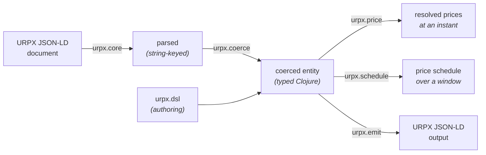

# clj-urpx

[](https://clojars.org/energy.grid-coordination/clj-urpx)
[](https://github.com/dcj/codox-md)
[](https://github.com/dcj/build-provenance)

Clojure library for [URPX](https://urpx.org) (Utility Rate Plan Exchange) — parse, validate, and resolve prices from URPX rate plan documents (JSON-LD).

## What is URPX?

URPX is an [LF Energy](https://lfenergy.org/) open standard for exchanging utility rate plan information using semantic web technologies (RDF, OWL, SHACL, JSON-LD). It enables precise, machine-readable data exchange between utilities, regulators, vendors, and researchers.

The standard's source of truth — ontology, SHACL shapes, JSON-LD context, tutorial, and reference test cases — lives at [github.com/urpx-org/urpx](https://github.com/urpx-org/urpx); its design-decision logs are maintained in [urpx-org/urpx-dev](https://github.com/urpx-org/urpx-dev). This library targets the same version-pinned ontology snapshot that fixtures cite via `urpx:targetURPXVersion`.

## What does this library do?

- **Parse** URPX JSON-LD rate plan documents into Clojure data structures
- **Validate & coerce** parsed data against [Malli](https://github.com/metosin/malli) schemas — string leaves become `BigDecimal`, `LocalDate`, `LocalTime`, `LocalDateTime`, `ZonedDateTime`, `OffsetTime`, `Duration`, `Period`, `Year`, integer month numbers
- **Resolve** the per-ledger, per-tier prices that apply at a given instant in a given timezone — TOU period, season, day-of-week, midnight-wrapping brackets, block-tier ladders
- **Generate** contiguous price-interval schedules suitable for [OpenADR 3](https://www.openadr.org/) events, either sampled on a grid or as exact segments whose boundaries come from the tariff
- **Emit** URPX JSON-LD from coerced Clojure entities (the inverse of parse + coerce) — useful for round-trip validation and programmatic authoring of URPX documents
- **Author** URPX entities idiomatically in Clojure via `urpx.dsl` — per-entity builders with auto-coercion, validation-on-construct, and keyword refs scoped via `dsl-scope`

## Library at a glance



Three paths share the same typed entity model:

- **Reading URPX docs** — load, coerce, and resolve prices → see [Resolving prices](doc/pricing.md)
- **Writing URPX docs** — emit JSON-LD from coerced entities → see [Writing URPX JSON-LD](doc/writing-json-ld.md)
- **Authoring URPX entities in Clojure** — build coerced entities idiomatically → see [Authoring URPX entities](doc/authoring.md)

## Installation

`deps.edn`:

```clojure
{:deps {energy.grid-coordination/clj-urpx {:mvn/version "0.60.0"}}}
```

## Getting started

A five-minute walkthrough using the vendored PG&E E-1 fixture (a real Schedule E-1 filing with block-tier pricing and a sibling vintage-PCIA modifier in a single JSON-LD `@graph`). Runs from a cold clone — no env vars, no sibling checkouts.

```bash
git clone https://github.com/grid-coordination/clj-urpx.git
cd clj-urpx
clojure -M:nrepl   # nREPL on the port written to .nrepl-port
```

In the REPL:

```clojure
(require '[urpx.core :as core]
         '[urpx.coerce :as coerce]
         '[urpx.price :as price]
         '[urpx.test-fixtures :as fixtures])
(import '[java.time ZoneId ZonedDateTime])

;; 1. Load the vendored PG&E E-1 fixture: a urpx:RatePlan + sibling urpx:RatePlanModifier
(def plan     (fixtures/load-rate-plan "pge-e-1-2026-03-01"))
(def modifier (fixtures/load-modifier  "pge-e-1-2026-03-01"))

;; 2. Resolve prices for July 4 2026 at 5pm Pacific (Summer, weekend, holiday)
(def la (ZoneId/of "America/Los_Angeles"))
(def july-4-evening (ZonedDateTime/of 2026 7 4 17 0 0 0 la))

(def resolved
  (price/resolve-prices-with-modifiers plan [modifier] july-4-evening))

(:urpx.resolved/season-name resolved)
;; => "Summer"

(mapv :urpx.resolved/ledger-name (:urpx.resolved/ledgers resolved))
;; => ["Energy Supply Prices" "Energy Delivery Prices"
;;     "Conservation Incentive Adjustment" "Adjustment Prices"
;;     "Base Services Charge"
;;     "Vintaged Power Charge Indifference Adjustment"]

;; 3. Marginal $/kWh — sum of the lowest-tier unit-prices across energy ledgers.
;;    The vintage-PCIA modifier prices one ledger per departure vintage. Those
;;    are mutually-exclusive ALTERNATIVES, exactly one of which applies to a
;;    customer, so say which one: without a selection `marginal-unit-rate`
;;    refuses rather than pick arbitrarily.
(def with-vintage
  (price/resolve-prices-with-modifiers
   plan [modifier] july-4-evening
   {:profile-alternatives {"pge:pa-departure-vintage" "pge:pa-vintage-2020"}}))

(price/marginal-unit-rate with-vintage)
;; => 0.36193M
```

Calling `marginal-unit-rate` on `resolved` instead, with no selection, throws `ExceptionInfo` naming the ledger: an aggregate that silently took one of eighteen mutually-exclusive prices would be reporting an arbitrary number as the marginal rate. Reading `:urpx.resolved/tiers` directly needs no selection, and still surfaces all eighteen.

That covers the consume side end-to-end. For emit and authoring, jump to [Writing URPX JSON-LD](doc/writing-json-ld.md) and [Authoring URPX entities](doc/authoring.md) — both compose with the coerced entity above.

## Documentation

- [Resolving prices](doc/pricing.md): timezones, holidays, modifiers, derived prices, horizons, which version applies, alternatives and conditions
- [Enumerating scenario cost models](doc/scenario-cost-models.md): which plan, version and modifiers apply, loading and walking a corpus
- [What a snapshot claims about itself](doc/coverage.md): reading `urpx:CoverageClaim`
- [Writing URPX JSON-LD](doc/writing-json-ld.md): emitting documents and round-trip fidelity
- [Authoring URPX entities](doc/authoring.md): the DSL, keyword references and typed definitions; [the DSL tutorial](doc/dsl-tutorial.md) works through examples
- [Schemas by type](doc/schemas.md): the registry, typed references and the drift audit against the standard
- [Status](doc/status.md): what is modeled and the known gaps
- [SHACL and Malli](doc/shacl-and-malli.md): why the schemas are hand-written

## Status

Targets the **URPX v0.5.1** release. Release history is in [CHANGELOG.md](CHANGELOG.md). [doc/status.md](doc/status.md) lists what is modeled and the known gaps.

## Namespace overview

| Namespace        | Purpose |
|------------------|---------|
| `urpx.core`          | JSON-LD parsing and loading (`parse-rate-plan`, `load-rate-plan`, `load-rate-plan-version`, `parse-graph`, `load-graph`, `expand-document-entities`) |
| `urpx.schema`    | Malli schemas for the coerced URPX entity model; `schemas`, `registry` and `schema-for-type` by `@type`; `ranges`, `instance-of?`, `mistyped-references` |
| `urpx.coverage`  | Optional reader for `urpx:CoverageClaim`: `of-version`, `of-model`, `descriptions`, `coverage-interval`, `verdict-applies?`, `claim`. Requires `urpx.index` only |
| `urpx.load`      | `document-xf`, `documents`, `scan`: sources to coerced documents, with the discards reportable |
| `urpx.coerce`    | Schema-driven coercion: strings → typed values; `coerce-doc` dispatches on `@type`; `validate`, `explain`; `uncoerced?` and `check-coerced!` tell a coerced document from a raw one |
| `urpx.index`     | `build-index`, `resolve-ref`, `get-entity` for `@id` references; `versions-by-plan` for v0.5.1 back-pointers; `single` and `entities-of-type`; `mistyped-references` over a set of documents |
| `urpx.price`         | `resolve-prices`, `resolve-modifier-prices`, `resolve-prices-with-modifiers`, `marginal-unit-rate`, `measurement-kinds`, `has-energy-ledger?`; `version-effective-at`, `version-expired-by?` and `version-covers?` are the single readers of a version window |
| `urpx.schedule`      | `price-segments` (exact boundaries, derived); `price-schedule`, `price-schedule-days`, `price-schedule-with-modifiers`, `price-schedule-days-with-modifiers` (stepped) |
| `urpx.tz-inference`  | `infer-zone` (opt-in fallback when `urpx:timezoneIdentifier` is absent) |
| `urpx.emit`          | Write-side: `write-rate-plan`, `write-rate-plan-modifier`, `write-urpx-package`, `write-scenario-cost-model`, `write-program-enrollment`; `write-entity` for any registered `@type` and `write-graph` for an `@graph` document |
| `urpx.validate`      | Single-file CLI checker (`clojure -M:validate <file.jsonld>`), tri-state exit |
| `urpx.dsl`           | Authoring DSL: `dsl-scope`, `make-builder`, named builders for every entity type |
| `urpx.defs`          | Typed definitions: `defurpx`, `kind-schema`, `defs-of-kind` |
| `urpx.scenario-cost-model`  | Optional enumerator: `enumerate`, `enumerate-pairs`, `identity-tuple`, `plan-versions`, `applicable-modifiers`, `offered-by`, `identity-status-at`, the `one-modifier-at-most` / `every-subset`, `named-versions-narrow` / `named-versions-add` and `repeated-ids-refuse` / `repeated-ids-union` policies, and `resolve-at` / `segments-for` / `schedule-for` for prices. Requires `urpx.price`; nothing in the library requires it |

## Command-line validation

Check any single URPX JSON-LD file, which is what a conversion smoke test needs while a set of filings migrates utility by utility:

```bash
clojure -M:validate path/to/filing.jsonld [more.jsonld ...]
```

Wrappers are descended, so a `urpx:URPXPackage` is checked through to the `urpx:RatePlan` inside it rather than at the wrapper metadata alone. Exit codes are tri-state so a run that checked nothing cannot read as success: `0` everything valid, `1` at least one entity failed, broke a rule the standard states, or holds a reference or inline node of the wrong type for its property (judged within the file), `2` refused because a path was unreadable or a file yielded no entity this library models.

## See also

- [URPX standard](https://github.com/urpx-org/urpx) — ontology, SHACL shapes, tutorial, and reference test cases (the upstream specification this library targets)
- [urpx-org/urpx-dev](https://github.com/urpx-org/urpx-dev): design-decision logs and development record for the URPX standard
- [urpx-rate-plans](https://github.com/grid-coordination/urpx-rate-plans) — production corpus of California utility rate-plan filings; vendored test fixtures here are frozen specimens taken from there
- [urpx.org](https://urpx.org): the URPX website
- [`doc/dsl-tutorial.md`](doc/dsl-tutorial.md) — worked DSL examples mirroring sections of the upstream URPX tutorial

## Contributing

Issues, Discussions, and pull requests are welcome — see [CONTRIBUTING.md](CONTRIBUTING.md) for the workflow (and the dev commands: tests, lint, nREPL), and [doc/RELEASING.md](doc/RELEASING.md) for cutting a release. In short:

- **Questions, API/design discussion, vocabulary gaps** → [Discussions](https://github.com/grid-coordination/clj-urpx/discussions)
- **Confirmed bugs, schema/resolver fixes, doc errors** → [Issues](https://github.com/grid-coordination/clj-urpx/issues)
- **Patches** → pull requests; please open a Discussion or Issue first for non-trivial changes (new schema classes, new DSL builders, new resolver behavior)

## License

Copyright (c) 2026 Clark Communications Corporation. [MIT License](LICENSE).

The vendored test fixtures under `test/resources/urpx-fixtures/` and the vendored `test/resources/corpus.schema.json` are licensed [CDLA-Permissive-2.0](LICENSES/CDLA-Permissive-2.0.txt).
